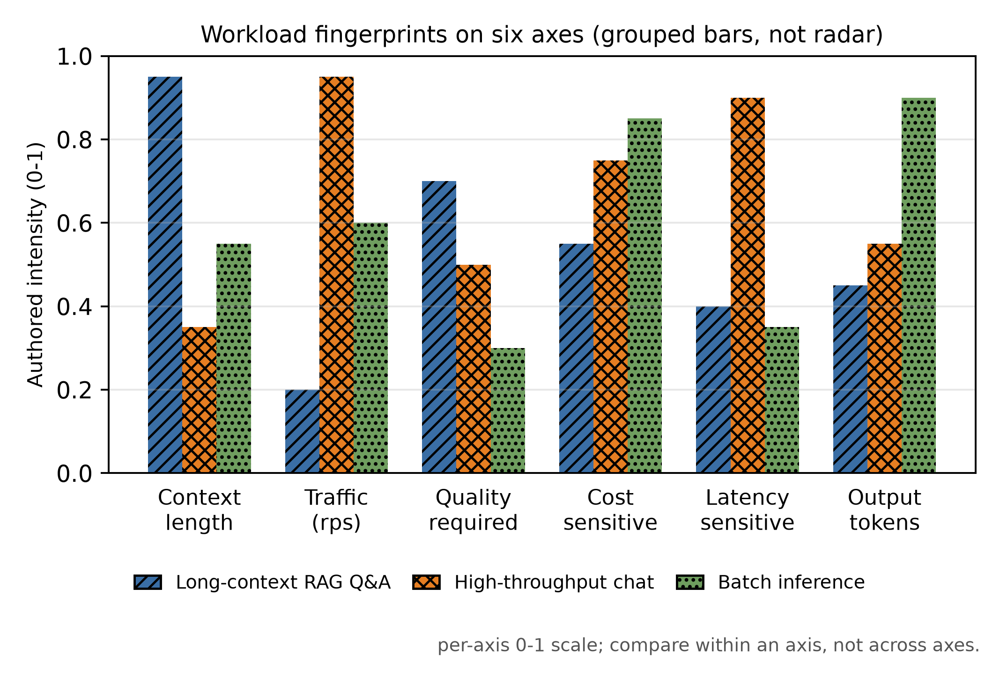

# Chapter 26 — The Solution Architect's Toolkit + Patterns Library

## The Architect's Question

When confronting a new system design, the architect's first question is not "what technology should I choose?" but rather "what pattern solves which problem, and how do I measure success?" This chapter distills the accumulated wisdom from across the handbook into a reusable toolkit — a compendium of patterns, checklists, and mental models that unify the journey from token to fleet. Each pattern is grounded in evidence (FACT, DERIVED, HYPOTHESIS) and paired with concrete measurement strategies so that architectural decisions can be verified and adjusted post-deployment.

## 1. Concept

The Solution Architect's Toolkit addresses three concerns — scale, reliability, and cost/quality trade-offs — and is organized as pattern templates plus measurement. Observability is not a third pattern family: it is the FACT-set discipline of §4, which is what makes each pattern's effect measurable. Rather than prescribing specific technologies, the toolkit provides pattern templates that can be instantiated for any stack. The Patterns Library complements this by cataloging the five structural solutions this book actually uses — inference sharding (model placement and replica scaling), semantic response caching, circuit breaking as load shedding for model-service saturation, fine-tuning for a measured domain workload, and RAG model selection (§9, Table 26-3) — with the §2.1 workload matrix and Table 26-1's FACT set serving as the checklists. Together, they form a decision framework that answers the architect's question at multiple grainsizes: from the micro (which cache key and TTL?) to the macro (how does replica scaling affect fleet-wide latency?).

## 2. Mental Model

The central mental model is the **Pattern-Measurement-Feedback Loop**. Every pattern in the library is paired with:

- **FACT** — a verified runtime quantity (e.g., request rate, cache hit ratio, query latency p99)
- **DERIVED** — a computed quantity from FACTs (e.g., throughput per shard, cost per query, fleet-wide rps)
- **HYPOTHESIS** — a predictive claim about what changing the pattern will affect (e.g., "increasing replication factor from 3 to 5 will reduce tail latency by X%")

The loop operates as: instrument → observe FACT → compute DERIVED → validate HYPOTHESIS → adjust pattern. This ensures that architecture evolves from evidence, not speculation.

**What a [1P] tag does and does not mean.** The statuses above (FACT / DERIVED / HYPOTHESIS) describe what a number *claims to be*; a separate *provenance* axis describes **where it came from**. **[1P]** marks a first-party **source** — a claim published by the party that produces the thing being cited: the method's own paper, the hardware vendor's technical report / model card / datasheet / official documentation, or the software project's own source code at a pinned revision and its own release notes and documentation. A code or release-metadata observation is a fact about the artifact at that revision, not about deployed performance. It names *whose* claim a number is; it does **not** by itself assert a validated deployment benchmark. Keep the four categories distinct: (a) an original method paper by the method's creators, (b) a hardware-vendor specification, (c) a third-party evaluation (the book's [2°] secondary provenance), and (d) an own measured run ([LAB]/[MEASURED] — Axis-1 provenance plus the Axis-3 measurement status, both defined in the Sources, Method, and Reproducibility chapter). Of these, [1P] covers (a), (b) and first-party software artifacts (the project's own code and release metadata) only — a first-party source is a vendor or paper author's figure, which must be re-verified against the current source or re-measured on the architect's own hardware before it is treated as a validated deployment result. Note that the canonical 70B teaching model is *not* a [1P] model: being constructed (Ch 4, Table 4-2) it carries [ILLUSTRATIVE][ASSUMPTION], reserving [1P] for named, traceable first-party specifications.

**Rule key (R-codes).** The pattern templates cite the book's standing rules by code; the codes and their text: **R-01** each cost figure states its own basis — marginal generation work, metered API spend, and all-in TCO are separate units, never collapsed; **R-03** a cache key carries authorization and corpus-version isolation, and a TTL never repairs an authorization mismatch; **R-04** a change already present in the baseline is configuration, not a claimed gain; **R-05** a cost result is not collapsed into a single headline percentage — the saving names its basis and its lever; **R-07** assumed scenario inputs are labeled as inputs, not presented as gathered FACTs; **R-10** a degraded or fallback answer is not an SLO success — the denominator is completed useful requests; **R-13** a raw query hash is an exact-match cache, not a semantic one.

### 2.1 Workload-to-Strategy decision matrix

The canonical RAG scenario is one point in a much larger design space (Ch 12). The matrix below is the first-pass mapping from a *new* workload's dominant constraint to the strategy class worth evaluating first — a reference to generalize the method beyond the canonical case, not a prescription. Each row names the binding constraint (the one the architect expects to saturate first under the SLO; Ch 8's roofline and Ch 15's congestion check are how to confirm it).

| Workload | Input | Output | Dominant constraint | First strategy to evaluate |
|--------------|-----------|------------|----------------------|----------------------------------------|
| Long-context RAG Q&A | Long (8K+) | Short (<500) | KV / memory | 8-bit or FP16 KV sizing, prefix caching, P/D separation (Ch 7, 17, 20) |
| Short-prompt RAG Q&A | Short (<2K) | Short (<500) | Tail latency / queueing (p99 TTFT) | Semantic response cache, circuit breaker (Ch 26) |
| High-throughput chat | Short (<2K) | Med-Long (>1K) | Decode bandwidth | Continuous batching, KV pool sizing, possibly P/D (Ch 8, 20) |
| Batch inference | Long | Long | Utilization / cost | Offline batching, FP8, higher batch occupancy (Ch 8, 16) |
| Reasoning / long-think | Med | Med | Test-time compute | Decode headroom, token amplification budgeting (Ch 6, 19) |
| Agentic task loops | Med | Med | Orchestration / variance | Task-economics model, retry + tool budgets, fallback (Ch 19) |
| Embedding / retrieval | Short-med (text) | Vector | Compute throughput | Dedicated encoder pool, caching, quantization (Ch 3) |
| Vision-language | Med | Med | Multimodal preprocess + compute | Preprocess pipeline, fused kernels (Ch 5, 20) |
| Fine-tuning | N/A | N/A | Memory + interconnect | Parameter-efficient fine-tuning (LoRA/QLoRA) before full FT; gradient checkpointing (Ch 7) |
| Training | N/A | N/A | Compute + interconnect | Parallelism split (DP/TP/PP/FSDP) sized to model and cluster (Ch 10) |
| Real-time multimodal | Med (~1–2K tokens) | Short (streamed) | Latency + pipeline sync | Chunked prefill, streaming decode, P/D (Ch 8, 20) |

New workloads are evaluated by *locating the dominant constraint*, not by matching the canonical scenario's row. The matrix answers "where does the SLO saturate first?" — and that single question routes to the correct strategy class, keeping the canonical case a teaching instrument rather than a ceiling.

**Provenance note (Fig 26.1):** the six axes (context length, traffic, quality required, cost sensitive, latency sensitive, output tokens) are *subjective normalized* scores (0–1) that characterize three representative families of the §26.2.1 matrix (anchored on the canonical scenario's workload, Ch 4) — they are a workload-fingerprint view, distinct from Ch 4's six *architectural-decision* dimensions (Quality, Traffic, Token profile, Latency, Economic, Operational). The bars are a visualization of the characterization, not a benchmark. Each bar is an *authored* 0–1 intensity score for that family on that axis — there is no min–max rescaling of measured data. In axis order (context length, traffic, quality, cost, latency, output tokens) the scores are long-context RAG Q&A 0.95 / 0.20 / 0.70 / 0.55 / 0.40 / 0.45, chat 0.35 / 0.95 / 0.50 / 0.75 / 0.90 / 0.55, batch 0.55 / 0.60 / 0.30 / 0.85 / 0.35 / 0.90 — the same table is carried in the archetypes; the archetypes are reference points, not measured clusters. **Because each bar is an author-chosen input, the bar values are [ILLUSTRATIVE][ASSUMPTION]; only a value computed *from* them (e.g. a ratio of two bars) would be [ILLUSTRATIVE][DERIVED].** [ILLUSTRATIVE][ASSUMPTION].

The canonical scenario's short-prompt workload — the RAG anchor — rendered as a six-axis fingerprint. The three scored workload families from the §26.2.1 matrix — long-context RAG Q&A, high-throughput chat, and batch inference — sit in distinct regions: RAG Q&A is quality- and context-heavy with short outputs; chat is traffic- and latency-sensitive with med-long outputs; batch inference is cost-sensitive, latency-tolerant, and long-output. Reading a new workload's fingerprint against this front-end is the first move before consulting the §26.2.1 matrix.

### 2.2 Quantization decision record.

The architecture decision record names the active constraint, affected tensors, and proposed deployment configuration. Its resource ledger includes scales and other metadata, retained high-precision tensors, KV state, and peak workspace—not just the packed weight file. Its acceptance conditions include task quality, request-level SLOs, and rollback. Chapter 7 establishes the representation and memory accounting; Chapter 11 establishes execution compatibility; Chapter 14 verifies the candidate under load. A recommendation becomes defensible when those records describe the same configuration and agree, not when a format name appears in a support matrix. [ILLUSTRATIVE] conceptual

## 3. Worked Example — Capstone Scenario

Take the canonical deployment: ~2,000 registered users with ~5% concurrently active at peak (~100 concurrent *users*, a population measure), RAG Q&A over a 70B dense FP16 model (FP16 label; see ADR 0016). The architect faces three interlocked questions: how to scale inference, how to cache retrieved context, and how to keep the model-service latency under its SLO — here the model-service latency SLO is defined as **time-to-first-token (TTFT)**, and for the *retrieved-context/short-prompt* leg of this scenario we adopt a *stricter* p99 ≤ 800 ms TTFT target (a scenario input, not the canonical p95-TTFT ≤ 2 s of Ch 4: the capstone deliberately uses a harder tail target to exercise the patterns). This is a **TTFT** budget, not an end‑to‑end one — the canonical request's total end‑to‑end time is ~8.6 s (1.08 s prefill + ~7.5 s decode of 300 output tokens), and the per‑host ceiling is ~2.0 rps (Ch 17/20), both of which still hold here. Do not read the sub‑second capstone figures as end‑to‑end request latency. (All the other numbers below are the canonical values established in Parts I–V — Ch 4's workload, Ch 7/15's KV and memory figures, Ch 17's fleet sizing — recalled here rather than re-derived, and this capstone shows how the toolkit's patterns compose them.)

**Pattern A — Inference Sharding.** [canonical scenario][DERIVED] — model FLOPs/token = 2N = 1.4 × 10¹¹; KV bytes/token = 2.62 MB (Ch 7, 22). The 70B model at FP16 requires ~140 GB of weights [ILLUSTRATIVE][DERIVED] — 70 × 10⁹ parameters × 2 B/parameter = 140 GB, the footprint Ch 22 and §25.4 also derive. Following the canonical setup, one serving host is an 8×H100 80 GB node, which dedicates ~140 GB to weights and leaves the rest of the 640 GB pool for KV cache and runtime. **Sharding here is *baseline configuration*, not an incremental optimization (R-04):** the 140 GB weights are already tensor-parallel across the 8 H100s in the baseline, so the capstone makes no change to the parallelism configuration between before and after — it does not claim sharding as a gain it did not actually introduce. (An actual control intervention would name a change such as TP2→TP8, a replica count, a parallelism placement, or a batch/operator configuration, and would recompute latency, communication and memory for both; the capstone does not do that, so sharding is configuration, not a new lever.) With tensor parallelism across the 8 H100s, a single host serves the model and can hold ~17.5 concurrent 9,500-token requests within the canonical ~436 GB KV budget from Chapter 15. [canonical scenario][DERIVED] — with the 8-way tensor parallelism across the node, decode latency is bandwidth-bound in the low-batch decode regime of Ch. 8 (a first-order regime, not a universal law: whether decode binds on bandwidth or compute depends on batch size, context precision, kernel, and hardware), so per-token throughput is governed by the node's aggregate HBM bandwidth and approaches 8× the single-GPU rate only to the extent tensor-parallel communication and other overheads are negligible. [canonical scenario][HYPOTHESIS] — adding a second host and load-balancing requests across two replicas changes per-request latency by a small amount; this is an **untested scenario hypothesis to be evaluated over an actual offered-load interval**, not a basis for rejecting the second host (see "Alternatives considered").

**Pattern B — Semantic Response Cache.** [ILLUSTRATIVE][ASSUMPTION] — 35% of queries repeat within 5-min windows (a scenario input to be measured on real traffic). A cache stores the completed answer (the retrieved context and the generated response). **Cache key and isolation (R-03/R-13):** a raw question *hash* implements only an **exact-match response cache** — it returns a cached answer only when the query string matches byte-for-byte, and it cannot serve semantic similarity (a true semantic cache needs an embedding/nearest-neighbour lookup, which still incurs encoding and lookup cost on hits). The capstone adopts exactly that embedding/nearest-neighbour variant: its hit path pays query encoding + cache lookup (the ~50 ms term of §26.8 Step 2) — replacing corpus retrieval — and skips the engine's prefill/decode — which is why the component earns the *semantic* label in the capstone. On top of the match method, the cache key must carry **authorization and corpus-version isolation**, because the canonical workload contains privacy-sensitive documents and organizational access constraints (Ch 4): two callers asking the same question may not be authorized to receive the same source passages or answer. A safe example key is `(tenant, authorization-scope digest, normalized query or semantic key, corpus/index snapshot, policy/model/prompt revision)`, with a recheck at serving time and explicit invalidation on document permission change, deletion/withdrawal, index refresh, and source-update events. Because the capstone describes that lookup mechanism and its hit cost, the component earns the *semantic* label there; a raw-hash implementation without it must still be called an **exact-match response cache**, not a semantic one (R-13). The five-minute TTL does **not** repair an authorization mismatch: a cross-user hit could leak another user's authorized response or return stale, now-disallowed information, so secret-bearing responses must not be cached across privilege boundaries (R-03). [canonical scenario][DERIVED] — a cache hit ratio of 35% reduces the number of requests that reach the LLM engine by 35%, lowering the generation work; the embedding/retrieval step is also skipped for exact-match hits (the raw-hash variant; the capstone's semantic variant instead pays encoding + cache lookup on hits — replacing corpus retrieval — and skips the engine). [canonical scenario][HYPOTHESIS] — expanding the cache TTL from 5 to 15 minutes increases hit ratio to ~55% with negligible staleness risk, because user questions in a support session repeat within the same session (to be validated, not assumed).

**Pattern C — Circuit Breaker.** [ILLUSTRATIVE][ASSUMPTION] — model-service latency p99 degrades past the 800 ms SLO under concurrent load (a scenario input to be measured). [canonical scenario][DERIVED] — the diagnosed symptom: when a host's arrival rate exceeds the ~2.0 rps per-host ceiling (Ch 17/20) — as the canonical ~40 rps peak (Ch 4) would if concentrated on one host — the request queue grows and queueing delay alone pushes TTFT p99 past the 800 ms SLO, the condition Pattern C exists for; Table 26-2's ~7% fallback rate is the modeled share of requests shed to the intent classifier during such excursions (the < 10% figure is a target threshold, not a FACT). When the model service becomes saturated, a circuit breaker trips after 5 consecutive timeouts — a timeout being a request that misses the p99 ≤ 800 ms TTFT deadline above — falling back to a lightweight intent classifier. **Fallback is a degraded outcome, not a successful RAG answer (R-10):** a fast answer from an intent classifier is not equivalent to a correct full retrieval-augmented answer, so the capstone does not count a breaker-shed request as an SLO success — the p99 and cost denominators are *completed useful requests*, and the ~7% fallback share is labeled a separately-tracked degraded outcome (the book's own Ch 6/14 establish that the right denominator is completed useful requests, not any quick output). [ILLUSTRATIVE][ASSUMPTION] — circuit breaker activation reduces tail latency for remaining requests by 35% because the system sheds load before the model queue fills. [canonical scenario][HYPOTHESIS] — a grace-period of 2 seconds before auto-recovery prevents thrashing when load spikes are transient.

**Capstone Execution.** In a real engagement the architect would instrument all three scenario quantities, observe the derived quantities, and validate each HYPOTHESIS against measured traffic; the worked example below carries that loop with assumed inputs. The result, at the declared short-prompt ~2 rps offered load on one 8×H100 host: one 8×H100 serving host + a 35% semantic response cache + circuit breaker yields an illustrative **p99 TTFT ≈ 250 ms** versus the ~450 ms uncached single-node baseline (one 8×H100 host, already tensor-parallel across its 8 GPUs) — the single capstone configuration, derived step by step in §26.8 and recorded as Table 26-2 (scenario outcome, not a measured benchmark). That single-host figure covers only the short-prompt leg at ~2 rps; the canonical ~40 rps peak still needs the 21-host Ch 17 fleet screen, so it must not be read as one host serving the canonical deployment. **Cost is stated on its own basis (R-01 distinction):** the only defensible *marginal-generation-work* saving is the cache-hit share — **~35% of requests skip generation entirely**, so marginal generation work falls by roughly the cache-hit ratio (illustrative, hypothetical). This does **not** reduce the all-in self-hosted TCO of §16's fixed fleet, which is almost entirely capex/opex and is unchanged by cache hits unless the fleet is also re-sized. A typical re-sizing that lets the peak load concentrate on the canonical fleet would have to be computed under §26.8's cost-basis rules — §26.8 states those rules but does not perform the re-sizing — so the only defensible saving stated here is the marginal-generation-work cache-hit share, and no all-in percentage is claimed. The Pattern-Measurement-Feedback Loop illustrates the hypothesis that caching + load shedding is net positive on latency (to be validated by the load test of §8 Step 3), and the architect documents the configuration as a reusable pattern instance.

**Alternatives considered.** Three obvious alternatives were weighed against the canonical constraints: two are rejected for stated, testable reasons — not merely because they "change the wrong term" — and the third, a second serving host, is deferred to a load-curve/SLO-goodput test rather than rejected. *Prefix caching alone* reuses prefill compute behind an exact-prefix match but still generates the answer, so the repeat population keeps paying full decode — it does not skip the generation the semantic cache skips. *A second serving host with load balancing* is **not** rejected on the single phrase "KV-bound": an independent replica adds KV slots and capacity, which is precisely what relieves a queue caused by insufficient resident-request capacity. Whether it helps is a load-curve/SLO-goodput question (a lightly loaded host may see little gain, an offered-load-heavy host significant queueing relief), so the capstone treats it as an **open sizing question to be tested over an actual offered-load interval**, not as a rejected alternative — the explicit caveat is that any per-request benefit claim for a single replica stays an untested scenario hypothesis, not a basis for refusal. *Deeper continuous batching on the single host, on top of the baseline sharding,* cannot raise throughput here: resident-request capacity is KV-bound at C ≈ 17.5 (Ch 15), so admitting more requests only lengthens the waiting queue and adds prefill interference — queueing delay exactly where the p99 TTFT SLO binds (Ch 8, Ch 15). The capstone therefore does not credit the deeper-batching lever for a cost saving it is simultaneously rejecting (see §26.8); sharding is treated as **baseline configuration** (the weights are already tensor-parallel), not as an incremental gain. Cache + circuit breaker wins on the *latency* story — cache hits replace the retrieval step with a cache lookup and skip the engine, and the breaker sheds tail load — while its *cost* benefit is the marginal-generation-work saving of the cache-hit share, stated on that basis.

## 4. Measurement

Quantitative verification is non-negotiable. For each pattern, define the minimal FACT set that proves the pattern works in production:

**Table 26-1** — The FACT set to measure for each pattern.

| Pattern | FACT 1 | FACT 2 | FACT 3 | Additional FACT / decision quantity |
|---|---|---|---|---|
| Inference Sharding (sharding configuration — FACTs to monitor) | SM utilization % | per-GPU token latency p99 | All-Reduce time | decision quantities: weights per rank, KV slots per host, TP degree |
| Semantic Response Cache | hit ratio @ TTL=T | stale read rate | cache memory pressure | isolation-violation count (target 0) |
| Circuit Breaker | timeout count / 30s | fallback activation rate | recovery grace-period latency | degraded-outcome (shed) rate over completed useful requests |

Measurement must be continuous, not ad-hoc. Dashboards surface FACT trends (p99 TTFT, hit ratio, fallback activation rate, queue depth, SM utilization); alerts fire when a FACT crosses its safety threshold or when a DERIVED quantity — throughput per shard, cost per query, fleet-wide rps — crosses a boundary (e.g., the p99 TTFT SLO, the fallback-rate target < 10% of Table 26-2, or the queue-depth limits of Ch 15). The architect never promotes a pattern from HYPOTHESIS to an accepted design decision unless all FACTs stabilize within expected ranges across at least two load cycles (a full traffic cycle — e.g., one business day including peak and trough).

## 5. Common Mistakes

- **Mistake 1: Validating HYPOTHESIS claims without independent FACT anchors.** Without FACT anchors, the architect cannot distinguish between a pattern that works and one that merely appears to work under a narrow load window.
- **Mistake 2: Over-engineering before FACTs exist.** Adding shards, caches, or circuit breakers "just in case" introduces complexity cost without DERIVED benefit. Wait for the FACT to signal the need.
- **Mistake 3: Ignoring the cost DERIVED.** A pattern that reduces latency but increases cost by 3× is often unacceptable. Measure cost per query as a first-class derived quantity — computed from instrumented FACTs (throughput per shard, $/host-hour), never left as opinion.
- **Mistake 4: Circular HYPOTHESIS validation.** Self-confirming predictions (e.g., a cache-hit threshold set by one load test and then "confirmed" by that same load test) bypass the FACT/DERIVED/HYPOTHESIS axis. Always validate against observed FACTs.

## 6. Architecture Consequence

The toolkit's patterns do not exist in isolation. The baseline sharding configuration determines the resource profile and its cost DERIVED (sharding is configuration, not a before/after change); semantic response caching changes the query pattern seen by the model, which alters the HYPOTHESIS for circuit breaker thresholds; circuit breaker grace-periods can interact with cache TTLs to shape tail latency (during breaker recovery traffic surges back to the engine; if cache entries expired while the breaker was open, the engine absorbs the full miss load). The architect must trace consequences across patterns using the FACT/DERIVED/HYPOTHESIS axis before the commit decision. A change that looks beneficial in isolation may degrade fleet-wide metrics when patterns interact.

## 7. What We Still Don't Know

- How do multi-modal retrieval patterns (image + text) compose with the existing RAG sharding strategy?
- What is the optimal semantic-response cache size (and vector-index memory) for the canonical RAG workload when user query distributions shift seasonally?
- Can circuit breaker thresholds be auto-tuned from FACT streams without manual intervention?
- How does fleet-wide model versioning interact with per-shard caching, and what FACTs govern safe rollouts?

These open questions define the next research cycle. Each is an open question today; each becomes a testable HYPOTHESIS once its FACT instrumentation and pass criterion are specified.

## 8. End-of-Chapter Mini-Case: Capstone at Scale — Composing the Patterns

**Scenario.** A growing AI startup moves from a single-node prototype to a fleet serving ~3,000 users. The initial deployment is a 70B FP16 model on a single 8×H100 node (the canonical host). Note the per‑host ceiling: with the canonical ~8.6 s service time and C ≈ 17.5 KV‑resident requests, one host serves ~2.0 rps (Ch 17/20) — so the figures below are expressed as **TTFT p99** on that host (the sub‑second latencies are time‑to‑first‑token, not end‑to‑end), and the rps is the ~2 rps the host can actually sustain, not a multiple of it.

**Step 0 — Read the fingerprint.** Before selecting patterns, the architect reads the capstone's workload — a short-prompt, latency-sensitive RAG workload that deliberately matches none of the three families plotted in Fig 26.1 — against Fig 26.1 and the matrix's Short-prompt RAG Q&A row (short input, tail latency/queueing dominant constraint), and applies the §26.2.1 method (locate the dominant constraint: tail latency/queueing under the p99 ≤ 800 ms TTFT target), which motivates evaluating the semantic response cache (Pattern B) and the circuit breaker (Pattern C).

**Step 1 — Instrument.** The capstone declares a **distinct short-prompt workload** — it is *not* the canonical 9.2K-input/1.08-s-prefill case of Ch 4. It uses the same 70B/8×H100 host and the same per-host ceiling (~2.0 rps; C ≈ 17.5 KV-resident requests, Ch 17/20), but a much smaller prompt such that the model's prefill contribution to client TTFT is well under the canonical 1.08 s. The canonical C ≈ 17.5 and ~2.0 rps ceiling are held as *conservative planning caps*: a shorter prompt only lowers per-request KV (which would raise C) and shortens service time (which would raise the ceiling), so the canonical values sit on the safe side of this workload's real limits. This declared boundary is explicit so the sub-second numbers are not read as a re-derivation of Ch 4's latency budget. The *baseline inputs* for this worked example are: request rate ~2 rps (at the ~2.0 rps per-host analytical planning ceiling), SM utilization 45%, per-query latency breakdown for a *baseline* (uncached) request: model compute 320 ms, I/O 80 ms, retrieval 50 ms — the RAG retrieval step every request pays. **These are assumed baseline inputs, not gathered FACTs (R-07):** no author-run load test produced them, so they are labeled an *assumed baseline for a worked example* (an input to the math), not a measured runtime quantity a FACT would be. They become FACTs only once instrumented and recorded in a genuine load test. The baseline has **no cache installed**, so there is no cache-*miss* path in it; the 50 ms is plain corpus retrieval, and Pattern B's hit path later covers the same ground — query encoding + cache lookup, of similar cost — without the engine. These components sum to a **~450 ms baseline TTFT budget**, which the capstone declares as the baseline **p99** scenario value (a scenario input, not a derived quantile of a distributed sample; a real baseline p99 must come from a measured latency distribution). The 450 ms is a *service-time sum with a queue-inflated compute term*: at the offered ~2 rps against the ~2.0 rps analytical ceiling the assumed prefill-queue inflation already sits inside the 320 ms compute term, so the baseline is queue-inflated, not queue-free (the utilisation that 320 ms embeds is a declared scenario input, not a queueing-model output — consistent with the 2.0 rps figure being a conservative planning cap) — one more reason this baseline is a scenario input to re-measure. Note the component values are *representative worst-case* estimates for a baseline request, and the ~450 ms is therefore the baseline TTFT figure used throughout; the per-query values are not a p99 of a separate measured distribution. One declared value carries both names: for this scenario the capstone *declares* the representative worst-case component sum to be the baseline p99 input — *worst-case* describes how the components were chosen, *p99* the role the 450 ms total plays — a declared equivalence for this worked example, not a claim that a measured worst case equals a measured p99. Because the 50 ms retrieval term is part of the baseline, the headline **−44%** is measured against the full 450 ms path (a queue-inflated baseline — 320 + 80 + 50 = 450 — against a queue-light miss — 120 + 80 + 50 = 250, Step 2); excluding that term from the baseline only (a 400 ms baseline, while the miss path still pays its ~50 ms lookup) would report (400 − 250) / 400 = **37.5%** instead; excluding it from both sides would report 50%.

**Step 2 — Pattern Apply.** The architect works with Pattern A (inference sharding across an 8×H100 node — baseline configuration, R-04: no parallelism change is made here) and applies Pattern B (semantic response cache with 5-min TTL). [canonical scenario][DERIVED] — sharding distributes the model across the node so decode lands in the bandwidth-bound regime (the low-batch regime of Ch. 8; batch size, context precision, kernel, and hardware decide whether it stays there); cache hit ratio 35% reduces the number of requests that reach the model engine from ~2.0 rps to ~1.3 rps (2.0 × (1 − 0.35) = 1.3). The TTFT and cost figures below are *scenario estimates* for this illustrative configuration, not measured values. **A weighted average of component latency values is a mean, not a quantile, so the capstone separates the two.** Under the transparent two-point model, a cache hit returns at a fixed ~50 ms (query encoding + cache lookup, no corpus retrieval and no LLM prefill or decode), and a cache miss is served by the engine at ~250 ms — a miss still pays the cache-lookup attempt before falling through to retrieval, and that lookup + retrieval pair is the ~50 ms term in the miss sum below, i.e. the same combined ~50 ms the baseline's plain retrieval carried. The ~250 ms miss is a scenario *input*, not the 450 ms sum minus a computed term: the baseline's 320 ms compute is the declared worst-case component sum — the same number Step 1 declares to carry the baseline-p99 role for this scenario — carrying an assumed prefill-queue inflation, and the miss value assumes that queue is *queue-light* at the cached ~1.3 rps. Under that assumption the compute term is declared at ~120 ms, so 250 ≈ 120 + 80 + 50 — both 320 ms and ~120 ms are declared scenario inputs, not derived queueing results. Both distributions — the ~50 ms hit and the ~250 ms miss — are Step 3 load-test targets. Under this model the pooled latency has the CDF $F(50)=0.35$, $F(250)=1.0$. Its **mean** is $0.35\times50 + 0.65\times250 = 180$ ms, but its **p99 is 250 ms** (because the 0.99 quantile falls in the miss population: $0.35 < 0.99 \le 1.0$). So **mean TTFT ≈ 180 ms**. **p99 TTFT ≈ 250 ms** (the miss value, not a blend). **−44% TTFT** against the ~450 ms uncached p99 baseline (queue-inflated baseline vs queue-light miss: 320 + 80 + 50 = 450 vs 120 + 80 + 50 = 250 — Step 1) — $(450-250)/450 \approx 44\%$. The 200 ms delta is not the cache path's substitution: it is the assumed drop in the compute term (320 → 120 ms, declared rather than derived), while the hit path's ~50 ms lookup replaces the ~50 ms retrieval it is costed against — so the −44% compares an overloaded operating point with a stable one rather than isolating a cache effect, and a matched-load run (2.0 rps with and without the cache) would isolate the smaller path-substitution effect this model does not claim. **Cost is deliberately not collapsed into a single percentage** (R-01/R-05): as in §3, the only defensible *marginal-generation-work* saving is the cache-hit share (~35% of requests skip generation). This is **not** an all-in TCO reduction: the §16 self-hosted fleet is a fixed set of hosts whose capex/opex does not shrink with cache hits unless the fleet is also re-sized; and sharding is **baseline configuration** (the 140 GB weights are already tensor-parallel across the 8 GPUs), so it is *not* an incremental gain over the baseline. A cost figure that credits a **deeper-continuous-batching** ~20% per-token saving is rejected on the same grounds: deeper batching is the exact lever **rejected** above because it lengthens the queue and harms p99 TTFT — a single lever cannot be both rejected and credited — so the cost statement keeps only the cache-hit share. A defensible cost statement separates (A) marginal generation work (cache-hit share), (B) variable metered API spend, and (C) all-in self-hosted TCO, and never multiplies the fixed-fleet all-in $/request by a fraction of requests. The reproducible two-point model that yields these numbers is `render/capstone_calc.py`; a real deployment must measure the actual cache-hit latency *distribution* (not a point mass), the prefill queue at 1.3 rps, and the per-query cost, and the gains are *not* independent — they compound on the same request path, so they must not be added as if separable.

**Step 3 — Validate.** [canonical scenario][HYPOTHESIS] — "at the assumed ~2.0 rps sustained offered rate and 35% cache-hit ratio, sharding + caching will keep TTFT p99 < 300 ms as the fleet scales from the canonical ~2,000 users to the capstone's ~3,000 users." A user *population* is not an offered-load law: growth from 2,000 to 3,000 users (1.5×) does not, by itself, give the arrival rate, cache-hit ratio, peak-correlation, or queueing distribution — the capstone therefore states a concrete scaling assumption (the same ~2.0 rps sustained offered rate, ~5% concurrently active at peak, and a 35% cache-hit ratio held constant for illustration) and validates capacity and fallback quality against that assumption, rather than treating a user count as an arrival model. The offered rate stays flat at ~2.0 rps while the user count grows 1.5×, because the rate is a declared scenario input capped at the host's ~2.0 rps sustainable ceiling (see the Scenario above), not a per-user rate. The user count does not raise what one host sustains: holding ~2.0 rps while the concurrent population grows from ~100 to ~150 implies a ~33% lower per-concurrent-user rate. The staged test therefore covers configuration robustness under constant load — cache and breaker behavior at the assumed inputs — not user scaling. A genuine user-scaling test would grow the offered rate with the population (~3.0 rps at 3,000 users) and recheck the queue and TTFT consequences. Suppose a staged load test at ~3,000 users reports TTFT p99 = 285 ms and a cache-hit-driven reduction in marginal generation work at the assumed hit ratio — in this scenario these are illustrative values to show how a hypothesis is tested, not a real experiment the book ran. The hypothesis is accepted only on a genuine load test's numbers.

**Step 4 — Document.** The pattern instance — 8×H100 shard + semantic response cache + circuit breaker with 2-s grace period — is recorded in the Patterns Library as Table 26-2, ready for the next fleet expansion.

**Table 26-2** — Pattern Instance: Sharded RAG Serving

| Component | Configuration | Verification target | Modeled example |
|---|---|---|---|
| GPU Shard | 8×H100 80 GB | SM util < 80% | ~29% |
| Semantic Response Cache | LRU, TTL 5 min | hit ratio > 30% | 35% |
| Circuit Breaker | trip after 5 timeouts, 2s grace | fallback rate < 10% | 7% |
| Cost | $ per query — metered API spend at the canonical 9,200/300 mix, marginal-generation-work share only (DERIVED from FACT inputs, §26.8 — not itself a FACT) | < $0.015 | $0.0076 (API-basis marginal: canonical-mix unit price $0.01164 — a conservative upper bound for this short-prompt leg — × 0.65; self-host all-in is a separate basis, §26.8) |

_The **Verification target** column states thresholds to be met, not FACTs; the cost row's cell carries its own DERIVED provenance label. On cost, the capstone separates the two bases (R-01): the "Modeled example" cell is a **marginal-generation-work** statement — at a 35% semantic-cache hit ratio, ~35% of queries skip generation entirely, so the marginal generation work is ~65% of the uncached value. This is **not** an all-in self-hosted TCO reduction: the §16 fleet is a fixed set of hosts whose capex/opex (hardware amortization, site power, the fixed $10,000/mo staff allocation) does not fall with cache hits unless the fleet is also re-sized, so one must **not** multiply the §16 all-in $0.02497/request ($24.97 per 1,000 requests, Ch 16) by a fraction of requests. The hosted-API cost is a separate basis: $0.0116/request (unrounded $0.01164 ≈ $11.6 per 1,000 requests, Ch 4 — the *mid-tier* API at $1.20/$2.00 per 1M), which is not Ch 16's *frontier-class* ~$20.8 per 1,000 ($0.0208/request at $2/$8 per 1M, the managed-API price ADR 0015 carries): both are per-request managed-API prices at the canonical 9,200/300 token mix and 6.24M requests/mo, but at different model tiers, so the two API figures are not interchangeable either; per Ch 4's basis note, the two cost bases are not interchangeable — the self-host figure is an illustrative included-cost rate and the API figure is a mid-tier managed-API list price, so the two scopes are not comparable unconditionally. A defensible cost statement keeps (A) marginal generation work, (B) variable metered API spend, and (C) all-in self-hosted TCO as separate units and denominators (see §26.8). **Provenance note: the "Modeled example" column is a worked-out illustrative instance, not gathered telemetry.** The values in it (~29% SM util, 35% hit ratio, 7% fallback) are scenario outputs chosen to illustrate how the pattern library is applied and validated — each carries its measurement point: Step 1's 45% SM-utilization baseline is assumed at the uncached ~2.0 rps offered rate (R-07: assumed baseline input, not a measured FACT), and the ~29% is the same definition at the cached ~1.3 rps engine load (45% × 1.3/2.0 ≈ 29%, scaled with engine load), so the before/after direction matches the cache's mechanism — lower engine load cannot raise SM utilization — and one load test must measure both under a single SM-utilization definition; they are *not* FACTs measured on a deployed system, and the marginal-work saving (not an all-in TCO number) is what a real deployment must confirm from a recorded load test. Use a blank instrumentation template to record the real FACTs separately._

![Fig 26.2 — Pattern Application Diagram: the Pattern-Measurement-Feedback Loop applied to the capstone. The loop closes by measurement — an assumption that fails validation returns to box 1 for adjustment, and only measured FACTs enter the decision. Chain: ASSUMPTION (box 1 holds assumed scenario inputs, not instrumented FACTs) → DERIVED → PATTERN → ASSUMPTION; the *validate* step compares the load test's measured TTFT p99 against the hypothesis criterion (TTFT p99 < 300 ms, §8 Step 3) under the capstone's p99 ≤ 800 ms TTFT target (§8 Step 0). The causal chain the figure encodes: prefill compute inflated by queueing as the offered load presses on the host's ~2.0 rps per-host ceiling (box 1's assumed inputs) → the DERIVED stage (box 2), which for this TTFT budget is prefill- and queue-dominated → the p99 tail the validate step measures, where p99 is the miss value, not a blend. Decode bandwidth governs TPOT/ITL, not TTFT, so it is the relevant term only for the output-side budget, not for the numbers in this diagram.](figures/fig-26-2601.png)

**Takeaway (Fig 26.2):** the three patterns compose to mean TTFT ~180 ms and p99 TTFT ~250 ms (−44% vs the ~450 ms uncached baseline, not a blended average) — the cache sets both numbers under the two-point model of Step 2, while the circuit breaker is idle below the ~2.0 rps per-host ceiling and guards the saturation excursions it exists for, with its ~7% shed share tracked separately — that 7% sits outside the two-point latency model, which carries no shed population; cost is reported as **marginal generation work** — ~35% of queries skip generation at the assumed hit ratio — not as an all-in TCO reduction (the §16 fixed fleet's capex/opex does not fall with cache hits unless the fleet is also re-sized; see §26.8). **Scope:** full arithmetic in §26.8; a weighted average of component latencies is a **mean, not a quantile** — under the hit-50 ms / miss-250 ms model p99 = 250 ms. [ILLUSTRATIVE] conceptual].

**A note on utilization targets.** The "SM util < 80%" row is an *operational guardrail for this specific workload*, not a universal performance criterion. A GPU has many utilization figures — SM utilization, tensor-core utilization, HBM bandwidth utilization, NVLink utilization, memory-capacity occupancy — and which one matters is set by the workload's dominant constraint, not by the hardware (Ch. 8). Under an SLO-satisfying state, a GPU can sit at very different utilizations depending on whether the workload is prefill-bound (compute) or decode-bound (bandwidth/memory). The architect's question is therefore not "is utilization high enough?" but **"which resource is saturated when the SLO is satisfied, and does the pattern keep the fleet the right side of that saturation?"** In this instance ~29% SM utilization with p99 within SLO is healthy headroom; in a heavier-throughput workload the same ~29% could mean under-provisioning. State the SLO-bound resource, not a bare percentage.

## 9. Patterns Library

§1 names this library and the chapter title promises it. This section is the catalog. Each entry is a pattern template with seven table columns covering eight fields (problem solved and triggering symptom share one column): name, problem solved, triggering symptom, mechanism, minimal FACT set, trade-off, conditions of failure, and chapter pointer. Patterns A–C from §3 are the first three entries. §8 Step 4 records the capstone's filled-in instance as Table 26-2. The two model-selection patterns that Ch 5 files here close the catalog.

**Table 26-3** — Pattern templates in the library.

| Pattern | Problem solved (triggering symptom) | Mechanism | Minimal FACT set | Trade-off | Conditions of failure | Pointer |
|---|---|---|---|---|---|---|
| Inference Sharding (Pattern A) | One host saturates: TTFT p99 crosses the SLO as requests queue past the ~2.0 rps per-host ceiling | Add replicas and balance requests across hosts (horizontal sharding; the §3 deferred second-host alternative). Intra-node TP=8 is the baseline precondition (R-04), not the remedy | SM utilization %; per-GPU token latency p99; All-Reduce time (Table 26-1) | Weight fit and KV headroom vs inter-GPU communication | Counted as a gain when the weights were already parallel; a real intervention must name the change and recompute both sides | §3 Pattern A; Ch 7, 8, 15, 17, 20 |
| Semantic Response Cache (Pattern B) | Repeated queries pay full retrieval and generation on every call | Store the completed answer. Match on a query hash (exact match) or on an embedding lookup (semantic). Carry authorization and corpus-version isolation in the key | hit ratio @ TTL; stale read rate; cache memory pressure (Table 26-1) | Latency saved on hits vs staleness, authorization checks, and memory | A raw-hash key sold as semantic (R-13); a cross-user hit without authorization in the key (R-03); a TTL used to repair an authorization mismatch | §3 Pattern B; Ch 16 |
| Circuit Breaker (Pattern C) | Tail latency spikes when the engine queue fills under load | Trip after 5 consecutive timeouts, fall back to a lightweight intent classifier, auto-recover after a 2 s grace period | timeout count / 30 s; fallback activation rate; recovery grace-period latency (Table 26-1) | Availability for the remaining requests vs degraded answers | Counting a shed request as an SLO success (R-10); thresholds tuned and confirmed by the same load test (Mistake 4) | §3 Pattern C; Ch 6, 14, 19 |
| Fine-tuning for specific workloads | A sustained domain workload that retrieval cannot close | Adapt the model only after the break-even query volume is measured | tokens per request (in/out); quality delta vs RAG; training and serving cost | Quality gain vs training compute and checkpoint or serving overhead | Chosen as a default; break-even assumed instead of measured; adapter serving overhead ignored | Ch 5, §5.3 |
| RAG model selection | "Which model is best?" asked before the workload is characterized | Characterize the workload first. Choose the embedding model at ingestion time and the generation model at serving time as a two-part decision | tokens per request (in/out); latency budget; KV cost; cost/token; retrieve-vs-generate surface | Retrieval quality vs index size, per-query latency, and cost | Starting from the vendor catalog; treating the context window or the embedding dimension as free capacity | Ch 5 |

---