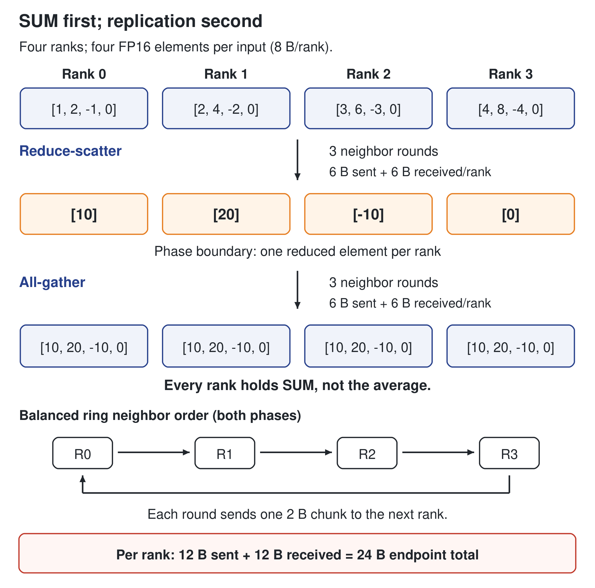

# Unapplied English manuscript candidates

Status: substantive candidate prose and original rendered figures; not applied. Source keys resolve in sources.md and claims.json. CCL-T* and CCL-F* are research identifiers, not final chapter/figure numbers. Automatic numbering and every affected cross-reference require verification after integration.

## Editorial integration map

The frozen proof is the publication baseline: 361 pages, US Letter, SHA-256 66f8392d6b768de7af4695b3d93d70b48858eb75a944020dbcfa9f4d1768b758. Source line numbers below refer to the source files read in this run and may move while the parent edits. Literal heading/paragraph anchors, rather than stale line numbers, control placement. Chapter 9 is parent-owned. Nothing in this proposal authorizes an automatic patch.

| ID | Exact target and anchor | Action and nonduplication boundary |
|---|---|---|
| CCL-T1 + CCL-F1 | design/manuscript/chapter-09/chapter-09.md, §1 Concept; replace list beginning `The collective operations that dominate multi-node training and inference are:` through the reduce-scatter bullet; read-run lines 11–15 | Extend the existing three definitions to a compact complete semantics reference. Insert the rendered reduction mechanism immediately after the table. Preserve the hardware hierarchy table. |
| CCL-T2 + CCL-F2 | Chapter 9 §2 Mental Model; before `Directionality comes before division.` (read-run line 36) | Add implementation layers and a fair MPI comparison. Keep interconnect hierarchy prose only once; do not turn this into a product catalog. |
| CCL-T3 | Chapter 9 §3 Worked Example; replace from `Take the canonical scenario:` through the paragraph preceding `## 4. Measurement` (read-run lines 51–75) | Parent merges with its existing arithmetic/memory fix, not an independent competing edit. Frozen defect primary: physical 141 / printed 123. Also reconcile §2, §5, §6, Fig 9.1 caption/data, old 22×/350× ratios and the 100-full-gradient repetition. |
| CCL-T4 | Chapter 9 §7 What We Still Don't Know; add a boxed sidebar immediately before the existing `Adaptive collective algorithms.` bullet (read-run line 113), or in a separately dated addendum | New dated implementation-status snapshot. Not silently part of the 2026-08-30 evidence envelope. Share status/support facts with the Intel XPU owner; this proposal owns only collective-library distinctions. |
| CCL-T5 | design/manuscript/chapter-10/chapter-10.md, §3 `### Tensor Parallelism: Splitting Weights Across GPUs`; replace paragraph beginning `With tensor parallelism, the 140 GB weight is split across GPUs.` (read-run line 67) | Replace vague per-token formula with group/shape/call-count example. Do not duplicate the strategy definitions or TP/PP/DP figure. |
| CCL-T5b | Chapter 10 §3 `### Data Parallelism: Replicating, Then Syncing Gradients`; paragraph beginning `per step (FP32 gradient;` (read-run line 99); frozen physical 152 / printed 134 | Correct directional accounting and clarify DP replica versus device rank. Preserve the already explicit FP32/FP16 difference. |
| CCL-T6 | Chapter 9 §4 Measurement; replace its numbered three-measurement list (read-run lines 81–85), keeping the same-stack invariant | Replace infeasible 140 GB single-GPU microbenchmark and ambiguous averaging of overlapped communication. Cite §14 for service-level benchmark design. |
| CCL-T7a | design/manuscript/chapter-08/chapter-08.md, §4 Measurement, immediately before `## 5. Common Mistakes` | One paragraph separating compute roofline and exposed collective stalls. No new compute-performance claim. |
| CCL-T7b | design/manuscript/chapter-11/chapter-11.md, §3 `### When to Disaggregate: Prefill and Decode Want Different Pools`, immediately before Table 11-1 | One paragraph separating KV transfer from TP collectives. Retain the serving-mechanism discussion; no new KV-capacity constants. |
| CCL-T7c | design/manuscript/chapter-14/chapter-14.md, §4 Measurement, before `## 5. Common Mistakes` | Short collective-to-service evaluation bridge, not another benchmark chapter. |
| CCL-T7d | design/manuscript/chapter-15/chapter-15.md, §4 Measurement, before `## 5. Common Mistakes` | Short critical-path/overlap resource accounting paragraph. |
| CCL-T7e | design/manuscript/chapter-17/chapter-17.md, §4 `### Cross-host interconnect budget`, immediately after its concluding `This calculation shows that cross-host communication must be dimensioned early` paragraph (read-run line 149) | Separate retrieval traffic population from model-parallel communication. Do not replace the independently derived retrieval burst/aggregate example. |
| CCL-T7f | design/manuscript/chapter-20/chapter-20.md, §4 Measurement, immediately after `A practical pitfall: measuring only aggregate rps` paragraph (read-run line 69) | Add group-level failure/straggler placement consequence without changing fleet sizing. |

Evidence cutoff control: the frozen Preface physical 17 / printed xi fixes 2026-08-30. Stable semantics and corrected derivations can be reviewed as corrections. Current NCCL/MPICH releases, current branch mappings and live deprecation notices belong in a dated 2026-10-28 research sidebar or a newly versioned edition. Applying any candidate requires the parent's controlled-update decision and a rebuilt proof. This file does not extend the edition's cutoff.

# CCL-T1 — Collective semantics before implementation

A collective operation describes how data from a group of ranks becomes a result. It does not specify a network, an algorithm, or a hardware vendor. A rank is an index within a communication group, not a synonym for a server. A single server can host several ranks, and several independent groups can occupy the same devices. The communicator identifies the participants and the context in which their operations match. [mpi50-pdf][nccl-init]

For a fixed-count all-reduce, each rank contributes an equal-length typed buffer. Corresponding elements are reduced, and every rank receives the result. SUM returns a sum. Averaging requires division by the group size or an explicitly selected averaging operation; it is not an implicit property of all-reduce. The reduction operation, dtype, element count, communicator and operation order form one contract. Matching buffer byte counts alone is insufficient. [mpi50-pdf][nccl-api-header]

| Operation | Input and result within one group | Architectural meaning |
|---|---|---|
| All-reduce | Corresponding elements are reduced; every rank receives the full result | Replicate a reduced activation or gradient tensor |
| Reduce | Corresponding elements are reduced; the designated root receives the full result | Aggregate without replicating the result everywhere |
| All-gather | Each rank contributes a fragment; every rank receives the rank-ordered concatenation | Materialize a tensor from distributed fragments; no reduction occurs |
| Reduce-scatter | Corresponding input elements are reduced; each rank receives a distinct result partition | Retain a sharded reduced result rather than a full replica |
| Broadcast | The root's buffer is copied to all participants | Distribute one source, not a sum of all inputs |
| All-to-all | Each source sends a destination-specific block; each destination receives one block from each source | Redistribute a source-by-destination partition, as in expert routing |
| Barrier | Completion requires every participant to have entered the group synchronization | Coordinate participants; not a substitute for device-stream dependencies |

The table uses equal-sized fragments where that simplifies the explanation. MPI also defines variable-count and derived-datatype interfaces. A tensor library may expose a narrower set of contiguous-buffer operations. In-place rules, supported dtype/op combinations and unequal-count behavior remain implementation-specific. [mpi50-pdf][nccl-api-header][oneccl-header]

Figure CCL-F1 follows one SUM through a balanced ring. Reduce-scatter leaves a different reduced fragment at each rank. All-gather then replicates those already reduced fragments. Gathering the original inputs would not produce the same result. This decomposition explains both the data distribution and the traffic; reduce-scatter is not the mathematical inverse of all-gather. [mpi50-pdf][nccl-performance]

Floating-point SUM adds another constraint. Its mathematical expression is unchanged when an implementation changes the reduction tree, but finite-precision addition can produce different bits. MPI explicitly recognizes this effect. A reproducibility claim therefore needs a scope: inputs, dtype, rank count and mapping, algorithm, kernels, hardware and software versions. A fixed random seed does not by itself establish bitwise collective reproducibility. [mpi50-pdf]

# CCL-T2 — From the framework to physical movement

The software path has several distinct decisions. The framework chooses a communication group and operation. Its backend connects that request to a collective implementation. The implementation chooses an algorithm and uses device execution and transport facilities. Those facilities share HBM, device links, PCIe, NICs and switches. Figure CCL-F2 separates these layers from the setup path. Changing a transport can leave the collective semantics unchanged while changing which resource limits the operation. [nccl-api-header][nccl-transport-code][oneccl-atl-mpi][oneccl-atl-ofi]

MPI is a standard, not one library and not a CPU-only transport. Open MPI, MPICH and Intel MPI are implementations. MPI defines blocking, nonblocking and persistent collective interfaces. GPU-aware implementations can accept supported device buffers, and eligible configurations can move their payload without staging it through host memory. Device-pointer recognition, direct RDMA, operation support and stream integration are separate capabilities. None follows automatically from the phrase “GPU-aware.” [mpi50-pdf][openmpi-cuda][mpich-v502]

The fair comparison is specific. Open MPI's v5.0.x CUDA documentation supports device buffers for several blocking collectives, but explicitly restricts nonblocking reduction collectives on the documented CUDA-aware UCX path. MPICH v5.0.2 documents CUDA, HIP and Level Zero build support; that statement is not a guarantee for every datatype, provider or persistent device-buffer operation. A nonblocking MPI request allows overlap. It does not guarantee independent background progress, and a correct MPI program must tolerate weak progress. [openmpi-cuda][mpich-v502][mpi50-pdf]

A typical NCCL call instead submits work to a CUDA stream. Stream order connects the collective to preceding producers and later consumers on that stream. A consumer on another stream needs an explicit dependency. A successful host return normally establishes submission, not completion of the result. Network paths can also use CPU proxy threads, so GPU-oriented communication does not imply zero host resource use. [nccl-streams][nccl-init][nccl-proxy-code]

MPI and NCCL can coexist. NVIDIA's example uses MPI to launch and coordinate ranks and distribute the NCCL unique ID, then calls NCCL for the tensor reduction. The presence of mpirun or MPI_Bcast in the application does not identify the collective payload path. Conversely, an MPI implementation may itself carry GPU payload, and oneCCL's legacy transport layer includes MPI as well as OFI paths. Bootstrap, collective algorithm and transport require separate labels. [nccl-example-mpi][oneccl-atl-mpi][oneccl-atl-ofi]

A ring is one execution strategy, not the meaning of all-reduce. A balanced point-to-point ring pipelines fragments through reduce-scatter and all-gather. Trees can reduce synchronization depth, and hierarchical algorithms can keep much of the traffic inside a fast local group. Pairwise exchanges serve a different redistribution pattern in all-to-all. Channels add parallel communication paths; protocols such as NCCL's LL, LL128 and Simple govern lower-level movement and synchronization. A protocol name is not an algorithm or a physical fabric. [nccl-ring-code][nccl-cost-model][nccl-env]

The useful choice depends on message size and topology. For small messages, launch and per-step latency can dominate. For large messages, sustained directional bandwidth and load balance matter more. Communication kernels may compete with model kernels for SMs, HBM and cache, while network progress consumes host and NIC resources. More overlap can therefore reduce exposed waiting yet slow the computation being overlapped. The architecture decision follows the combined critical path, not a library name or an isolated bandwidth score.

# CCL-T3 — Directional bytes: a ring calculation, not a deployment benchmark

Assumptions and evidence. This example retains the book's logical 140 GB FP16 gradient and eight participants to expose the traffic accounting. All sizes are decimal GB. The algorithm is a balanced point-to-point ring with equal fragments, no compression and no collective offload. H100 SXM's nominal NVLink bandwidth is 900 GB/s per GPU as a bidirectional aggregate, equivalent to 450 GB/s in each direction. The byte counts below are derived; the completion times are analytical byte terms, not measured NCCL results. [canonical scenario][DERIVED] [ANALYTICAL]; hardware input [1P][FACT]. [h100-datasheet][nccl-performance]

A ring divides a logical buffer of M bytes into N fragments. Reduce-scatter sends N−1 fragments per rank. All-gather sends another N−1. The receive volume is the same:

S = R = 2(N−1)M/N.

For M=140 GB and N=8, each rank sends 245 GB and receives 245 GB. Its aggregate endpoint traffic is 490 GB. The ideal bandwidth term is therefore

T_bytes = S/B_send = 245/450 = 490/900 ≈ 0.544 s.

The equivalent divisions use different byte populations but matching bandwidth populations. Dividing 245 GB by the bidirectional 900 GB/s would count the transmit bytes once while counting transmit and receive capacity together. That halves the estimate without removing any work. A one-way transfer of the logical 140 GB, which is not the ring collective, instead has the nominal byte term 140/450≈0.311 s. [nccl-performance][h100-datasheet]

| Analytical path | Directional bandwidth used | Eight-rank ring byte term |
|---|---|---|
| H100 NVLink port aggregate | 450 GB/s send, from 900 GB/s bidirectional nominal | 0.544 s |
| Illustrative two-rail network path | 40 GB/s send, assumed effective value | 6.125 s |
| Illustrative Ethernet path | 2.5 GB/s send, assumed effective value | 98 s |

The network values are scenario assumptions, not validated achieved bandwidths. With those assumptions, their byte terms are 11.25 and 180 times the nominal NVLink byte term. Real latency also includes per-step synchronization, reduction work, transport overhead and contention. A simple model adds 2(N−1)α, but does not capture every pipeline or dependency. The model's value is dimensional consistency, not a promise of achieved time. [ILLUSTRATIVE][ASSUMPTION] (network inputs); [ILLUSTRATIVE][DERIVED] [ANALYTICAL] (comparisons).

The memory constraint still applies. A 140 GB input buffer cannot reside on an 80 GB GPU. Even 160 GB of combined device memory holding 140 GB of weights does not establish training-state fit. A real hybrid DP×TP configuration must state its per-device parameter and gradient shards and identify the actual communicator. The example is a logical traffic comparison; it is not an executable eight-H100 benchmark specification. A feasible benchmark uses resident per-rank buffers and separately documents how its measurements inform the larger workload. [h100-datasheet][nccl-init]

The ring bound also has a mechanism boundary. Hardware multicast or in-network reduction changes the movement counted by a point-to-point model. NCCL documents NVLS/NVLSTree paths for supported NVLink SHARP configurations. Their measured time should be interpreted against the actual offload path, not rejected because it differs from a ring estimate. nccl-tests likewise states the point-to-point scope of its all-reduce traffic argument. [nccl-env][nccl-performance]

Finally, frequency matters. Repeating a full 140 GB all-reduce 100 times multiplies its traffic by 100. Splitting one 140 GB gradient into 100 buckets does not: it preserves the total logical gradient bytes while changing launch count and overlap opportunities. Parameter size alone cannot determine iteration communication time.

# CCL-T4 — Dated implementation note: similar semantics, different integration contracts

Research snapshot, 2026-10-28; outside the edition's 2026-08-30 cutoff. These observations describe fetched documentation and source, not tested binary interchangeability.

NCCL's latest GitHub release at retrieval was v2.32.3-1, published 2026-09-17. Its tagged API includes all-reduce, all-gather, reduce-scatter and all-to-all, among other operations. Its source contains topology discovery, graph search, transport selection and an algorithm/protocol cost model. Current official documentation also describes a device-side API, introduced in the 2.28 series, with capability-dependent local and network paths. This extends the host stream API; it does not mean that every accelerator or NIC supports every device-side mechanism. [nccl-release][nccl-api-header][nccl-topo-code][nccl-search-code][nccl-cost-model][nccl-device-guide]

oneCCL's official UXL repository was not archived at retrieval. Its default branch was master-v2. GitHub's latest release was 2022.1.0, published 2026-08-15; the version identifier is not its release year. That tag exposes a C API and a plugin architecture. Its legacy plugin connects to the existing C++ collective implementation, and its tree contains MPI and OFI transports. SYCL/Level Zero describe the device execution and memory path; MPI/OFI describe transport choices at another layer. Actual device-buffer support still depends on the selected plugin, transport, build and system configuration. [oneccl-repo][oneccl-release][oneccl-header][oneccl-v2-readme][oneccl-legacy-plugin][oneccl-atl-mpi][oneccl-atl-ofi][oneccl-env]

Queue semantics are part of that contract. The inspected 2022.1.0 legacy plugin expects an in-order SYCL queue for its queue path. Its CPU branch with a null stream waits on an event, and other branches contain queue waits or host tasks. The broad description “asynchronous GPU collective” cannot replace those path-specific completion rules. Similar-looking function names also do not establish matching error, lifetime or recovery semantics. [oneccl-legacy-plugin]

The C API has a concrete plugin error boundary. In the inspected tag, its wrapper converts caught C++ exceptions into onecclPluginException. A communicator without a finalize or abort callback causes the corresponding API to return onecclNotImplemented. This is a conditional code path, not a claim that every plugin lacks recovery callbacks. A synchronous return code also does not establish completion of previously queued device work; runtime failures and the selected plugin's recovery behavior remain separate obligations. [oneccl-api-code][oneccl-legacy-plugin]

The older intel/torch-ccl binding project is a different lifecycle question. Its README declares the project archived and deprecated and directs distributed use toward PyTorch itself. PyTorch v2.9.0 documents the XCCL backend for XPU devices. A separately inspected torch-xpu-ops commit uses onecclComm_t and oneCCL wrappers within ProcessGroupXCCL. This supports a backend-to-library distinction, not a claim that every PyTorch release uses the same ABI or that a standalone successor called Intel XCCL has been verified. Proposals in a PyTorch RFC are not release evidence. [torch-ccl][torch-v29-doc][torch-xccl-code][xccl2-rfc]

| Comparison dimension | NCCL path | Inspected oneCCL path | MPI path |
|---|---|---|---|
| Identity | NVIDIA collective library | UXL collective library with tagged C API/plugin path | Standard implemented by Open MPI, MPICH and others |
| Device integration | CUDA streams; conditional device API | SYCL/Level Zero path; inspected legacy plugin has in-order queue requirements | Device-buffer, progress and stream behavior depend on implementation/component |
| Execution choices | Topology-aware algorithms, protocols and eligible offload | Selected plugin, collective implementation and transport | Implementation-selected collective algorithms and communication components |
| Setup | Communicator IDs/ranks supplied by application or framework; MPI may assist | Communicator/plugin setup; launcher and transport are separate choices | Implementation process/runtime and communicator facilities |
| Portability claim | Not a vendor-neutral execution ABI | API similarity does not imply binary or behavioral interchangeability | Standardized semantics do not make all GPU extensions portable |

RCCL and UCC clarify the same architectural distinction without requiring a product catalog. RCCL implements collective semantics in the ROCm/HIP ecosystem. UCC can provide collectives to different programming models and integrates with Open MPI. Gloo is both a communication library and a framework backend name. Actual operation and device support must be checked at the framework boundary as well as in the underlying library. No performance ranking follows from this table. [rccl][ucc][gloo][torch-v29-doc]

# CCL-T5 — A shape-based TP communication budget

Tensor parallelism keeps weight shards resident and exchanges layer results. In a row-parallel linear layer, ranks compute partial outputs from their local weight shards; a reduction combines those partial outputs. Other layouts can use reduce-scatter and all-gather instead. The buffer shape, communication precision, group size and number of collective calls determine the byte budget. Ordinary TP decode does not fetch the full model weights over the network again for every token. [megatron-layers][megatron-mappings]

Consider a small illustrative decode step with 16 active sequences, one new token per sequence, hidden width 8,192, two-byte BF16 communication and eight TP ranks. Assume two output all-reduces per transformer block, 80 blocks, no sequence parallelism, and a balanced point-to-point ring. These are explicit teaching inputs, not a measured model configuration. [ILLUSTRATIVE][ASSUMPTION] [ANALYTICAL]

Each all-reduce has a logical input of

M = 16 × 8,192 × 2 = 262,144 B = 256 KiB.

The ring sends 1.75M=448 KiB per rank and receives another 448 KiB. Across 160 calls, each rank sends 70 MiB and receives 70 MiB in that decode step. The ideal byte term is about 0.163 ms at 450 GB/s directional bandwidth, or 2.936 ms at an assumed 25 GB/s. Neither is an inter-token-latency prediction. The simple ring also contains 160×14 communication steps, plus launch, compute dependencies and contention. At this message size, latency and progress can matter more than the large-buffer bandwidth score. [ILLUSTRATIVE][DERIVED] [ANALYTICAL]; ring normalization [nccl-performance].

The token population is the rows processed in this step, not the full historical context length. Prefill may process many more rows. A different sequence-parallel layout, fused kernel or offload path changes the operation and its schedule. The budget therefore begins with the deployed layer trace, not a fixed “bytes per model” rule. This distinction also changes the economics: a faster nominal fabric may not reduce the host count if launch overhead, compute or memory residency remains binding.

For expert parallelism, the population is routed token copies rather than TP partial outputs. With eight EP ranks, 256 local tokens per rank, top-2 routing, hidden width 8,192 and BF16, an illustrative uniform routing model produces 8 MiB of route rows per rank. Seven eighths go remote: dispatch sends and receives 7 MiB per rank. An equal-sized combine doubles those totals to 14 MiB sent and 14 MiB received. This excludes metadata, padding, compression, route deduplication and load skew. A hot destination can dominate completion even when the average byte budget fits. Specialized dispatch/combine implementations may exploit structure that a fixed-count all-to-all does not expose. [ILLUSTRATIVE][DERIVED] [ANALYTICAL]; implementation context [deepep].

FSDP changes the object again. Its communication can gather a module's parameter shards before computation and reduce-scatter that module's gradients afterward. An illustrative 64 MiB unit split eight ways requires 56 MiB sent and 56 MiB received per rank for a balanced ring all-gather; the same full-size gradient gives the same per-rank reduce-scatter volumes. This is a unit-sized calculation, not a claim that every forward gathers the whole model or every optimizer state. [torch-fsdp][nccl-performance] [ILLUSTRATIVE][DERIVED] [ANALYTICAL]

# CCL-T5b — Replacement DP directional-accounting paragraph

The 280 GB is the logical FP32 gradient size per full replica. It is not the network traffic. Under the eight-rank point-to-point ring model, each participating rank sends 490 GB and receives 490 GB. A directional 25 GB/s path gives a 19.6 s byte term. The H100 nominal directional 450 GB/s gives 1.089 s, not 490/900 s. Both are analytical comparisons, not feasible single-80-GB-device gradient allocations. In hybrid DP×TP training, the DP communicator often contains matching parameter shards from different replicas; its actual per-device buffer and group must replace this full-replica logical example. [canonical scenario][DERIVED] [ANALYTICAL] [nccl-performance][h100-datasheet][nccl-init]

# CCL-T6 — Measuring an implementation, then measuring the service

A communication benchmark needs a complete contract: operation, dtype, reduction, count, layout, group size, device mapping, software versions and transport. “Eight GPUs” alone does not establish comparable work. The runtime, driver, network plugin, NIC firmware, topology, NUMA affinity and selected algorithms belong with the result. Device-pointer acceptance does not prove a direct RDMA path; logs and counters must confirm the path actually used. [nccl-env][nccl-troubleshoot][openmpi-cuda][oneccl-env]

Three measurements separate the causes:

1. Correctness and completion. Known inputs establish SUM, roots, rank order, partitions and all-to-all destinations. Floating-point comparisons use a documented tolerance, with bitwise repeatability reported separately. Producers must complete before the operation consumes their buffers; consumers must observe device completion, not just host submission. Unsupported combinations remain marked unsupported. [mpi50-pdf][nccl-streams][oneccl-legacy-plugin]
2. Collective performance. nccl-tests, the matching oneCCL tests/examples or a validated GPU-aware MPI test run on feasible resident buffers. Small activation messages and larger gradient buckets both matter. The report states warmup, sample count, repeated trials, the timing boundary and rank aggregation. Host enqueue time and device-completed latency are distinct. Original time is retained alongside the precisely defined algbw and busbw normalization. busbw is not a physical-link byte counter. [nccl-tests-readme][oneccl-v2-example][openmpi-cuda][nccl-performance]
3. Service impact. The same collective shapes run within the real compute and arrival schedule, first in isolation and then with concurrent traffic. Profiler traces separate exposed communication stalls from hidden work and from compute slowed by resource contention. TTFT, ITL, errors and SLO-goodput determine whether the collective change improves the deployment; a large-buffer microbenchmark does not establish that result.

Failure tests are part of the same evaluation. Missing ranks, divergent operation order, count mismatches, network faults and process exits can block a group. Framework watchdogs, library asynchronous errors and request deadlines need a coherent recovery policy. An asynchronous success code does not establish result correctness after the communicator has failed. Recovery is validated at the framework and service boundary rather than assumed to be a transparent property of the API. [mpi50-pdf][nccl-init][torch-v29-doc]

# CCL-T7 — Short cross-chapter bridges

## CCL-T7a — Chapter 8, compute

A compute roofline does not include every exposed distributed stall. A communication kernel can consume SM and HBM resources while appearing to overlap a matrix multiplication. The joint trace must therefore distinguish model computation, collective work, exposed waiting and computation slowed by contention. Peak interconnect bandwidth cannot be added to peak compute to predict the combined schedule; Chapter 9 separates their mechanisms and measurement boundaries.

## CCL-T7b — Chapter 11, KV transfer

The state crossing between prefill and decode pools is a different communication object from a TP activation reduction. Its endpoints, ownership, block layout and transfer frequency must be stated independently. A KV-transfer path may use point-to-point or specialized transfer facilities rather than a group collective. The service budget includes transfer and orchestration on the request's critical path; it does not count a whole KV cache again on every ordinary decode step. Chapter 9 provides the directional byte convention, while this chapter determines when moving ownership is worthwhile.

## CCL-T7c — Chapter 14, evaluation

Collective microbenchmarks isolate one communication mechanism; they do not establish serving capacity. A deployment comparison preserves the layer shapes, precision, group mapping and arrival process, then measures device-completed work and SLO-goodput under contention. Cross-vendor tests compare complete systems unless hardware is controlled; they cannot isolate a library-only speedup. Chapter 9 supplies the correctness and traffic-accounting contract.

## CCL-T7d — Chapter 15, overlap

Summing all collective durations overstates exposed cost when operations overlap. Subtracting every overlapped duration can understate cost when communication slows concurrent compute. The measured quantity is the change in the end-to-end critical path, supported by compute and communication traces. CPU progress threads, HBM, device links and NICs remain shared resources even when their work appears in separate profiler lanes. [nccl-proxy-code]

## CCL-T7e — Chapter 17, fleet traffic population

The retrieval example budgets request-driven cross-host traffic. A distributed model adds a different population: TP or EP participants communicate at layer or routing boundaries, and KV transfer follows request ownership. Those operations use their actual communication groups, not the total number of serving hosts. Independent inference replicas do not acquire a cross-fleet gradient all-reduce merely because more hosts are added. Their separate schedules and shared-link contention determine whether the retrieval budget remains valid. [megatron-mappings][deepep]

## CCL-T7f — Chapter 20, operational consequence

Placement also determines the communication and failure domain. A slow or failed participant can delay an entire model-parallel group while other replicas remain healthy. Group-level completion tails, asynchronous failures and the affected requests therefore accompany per-host utilization. A placement that improves average utilization but increases cross-group contention can reduce SLO-goodput; replica isolation and group recovery require measurement before they become fleet-capacity assumptions.

## Parent verification checklist

- Merge Chapter 9 arithmetic through its owner; reconcile Chapter 10's remaining bidirectional denominator independently.
- Preserve evidence axes: assumed inputs, derived numbers and analytical—not measured—status are separate.
- Decide controlled new-edition versus dated-sidebar treatment of current release facts.
- Copy no assets until the parent accepts the insertion map. Refer to figures/manifest.json for SVG/PDF/PNG, captions, alt text, claims, dimensions and reproduction command; figures/QA.md records actual inspection.
- Rebuild the full proof, inspect figures at the actual placed 6.1-inch width and verify all automatic numbering/cross-references. The research output does not certify that future proof.
