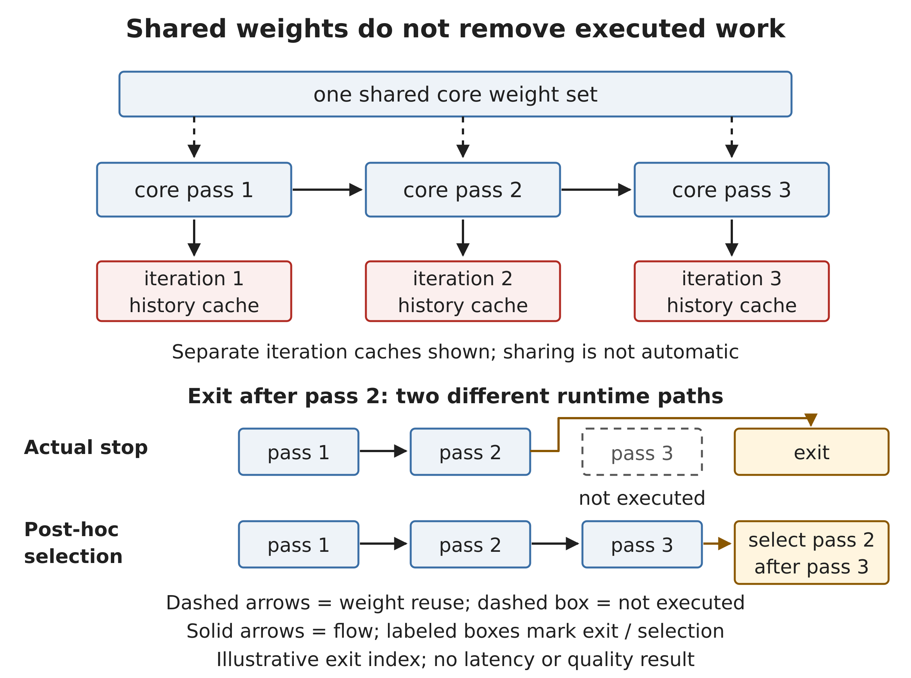
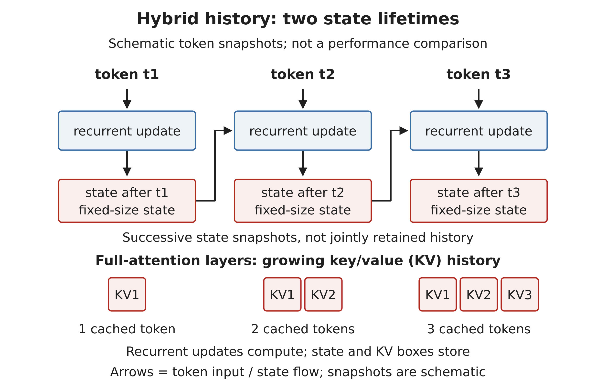

# Candidate insertions — not applied

Editorial status: research and proposed prose only. No byline. Placement anchors refer to the current Markdown sources, not verified PDF page numbers. The minimum package is A plus its table and MT-2, B plus MT-1, C's execution-budget example, D's serving discussion, and short cross-references from Chapters 3 and 19. E–F provide optional replacement or expansion text; they are not intended to repeat A in every chapter. The original four-family appendix comparison retains its own date and scope.

## A. Independent dated appendix subsection

Proposed placement: `design/manuscript/chapter-27/chapter-27.md`, a new separately dated subsection immediately after §7 “The Frontier Question: Where Should Intelligence Live?” and before §8 “First-hand Sources (all [1P]).” Preserve the 2026-08-30 comparison and separately dated 2026-09-27 observation; the October evidence does not inherit either earlier boundary.

### Dated update — architecture evidence retrieved on 28 October 2026

This update is separate from the four-family comparison compiled through 30 August 2026. A retrieval date is not a release date. Some examples below were available before that comparison; others are later releases or later paper revisions. The purpose is to examine mechanisms that change a deployment decision, not to extend a model ranking.

#### Three independent dimensions

A model description now needs at least three independent dimensions: parameter allocation, history-state representation, and execution depth. Dense feed-forward layers can coexist with recurrent token mixing. Sparse experts can coexist with global attention. Shared weights can execute repeatedly within one token prediction. None of these properties determines the others.

`Qwen/Qwen3.8-27B` is a useful counterexample to the idea that a dense model must use conventional full attention throughout. Its card describes dense feed-forward layers and native image/video understanding. Its language configuration contains 48 Gated DeltaNet layers and 16 full-attention layers. DeltaNet updates a recurrent history state; the full-attention layers retain a separate history-dependent KV component. Dense parameter allocation therefore does not imply a full-MHA cache formula.[^q27]

A different form of recurrence repeats a shared core over the current representation. Huginn and Ouro provide public research examples. Their shared weights reduce the unique parameter inventory relative to an equally deep untied network. The repeated executions still consume compute. Attention states can also differ between iterations, even when the weights are identical. These research artifacts are not evidence that adaptive-depth production serving is already routine.[^huginn][^ouro]

| Mechanism | Repeated or selected object | Main budget consequence | Important boundary |
|---|---|---|---|
| MoE routing | Selected feed-forward experts | Active compute and expert traffic differ from total residency | Sparse activation does not make all weights disappear |
| History recurrence | A state updated across input tokens | Some history components can have bounded decode state | Remaining attention layers can still grow with history |
| Shared-depth recurrence | A core reused within a prediction | Compute depends on executed depth; iteration caches may remain distinct | Shared weights do not imply shared KV |
| Speculative decoding | Draft candidates followed by target verification | Cost depends on accepted tokens per verification and draft overhead | It is not shared-depth reasoning |
| Agent orchestration | External model and tool calls | Turns, replay, branches, and tool time determine task cost | It is not an internal layer loop |

This table classifies mechanisms, not performance results. A single model can combine several rows.

#### Phase and storage tier matter

`deepseek-ai/DeepSeek-V4.1-Flash` changes more than one constant. Its vendor report describes a Causal Encoder-Decoder with 552B backbone parameters and a separate 196B Engram component. It reports 8B activated parameters per token during prefill and 16B during decode. A single active-parameter figure would obscure this phase difference. These counts describe the vendor's computation paths; they do not establish an elapsed-time ratio.[^ds41]

The report also separates memory objects. Cross-layer reuse and FP4 main-KV storage produce a reported global HBM KV footprint of 890 bytes per token. This is not total request memory. Bounded sliding-window state, weights, workspaces, and allocation overhead remain separate. The reported persistent-cache reduction to approximately one-eighth of DeepSeek-V4-Flash concerns host or SSD storage under SWA Bounded Replay. It is not the same metric as global HBM KV.[^ds41]

The transferable rule is to account for each independently stored state, its update rule, and its location. Sparse attention that reads selected history entries need not store only those entries. Cross-layer consumers can share one stored object. A local window can bound live state while prefix restoration still incurs storage or recomputation. Capacity across several accelerators also does not establish that each rank fits its assigned weights and state.

#### A stopping rule is not yet a runtime saving

Huginn's model card requires a recurrence-aware cache so that later core passes do not overwrite earlier KV entries. It also labels its per-token adaptive-compute facility a zero-shot proof of concept. Its stopping criteria include changes in latent state, output distributions, and prediction stability.[^huginn]

Ouro's revised paper studies learned exit decisions and cache sharing. It reports that prefill needs distinct iteration caches in the evaluated setting, while selected decode-only sharing strategies can reduce the cache component. These are phase-specific experiments, not a universal reduction in whole-request memory.[^ouro]

The released runtime path also matters. In the Ouro implementation retrieved for this update, the core loop computes all configured iterations before the language-model wrapper selects an exit representation. That path does not demonstrate skipped core computation merely because an earlier representation is selected. The model card separately states that its vLLM path does not support adaptive exit. A paper's stopping policy, a reference implementation, and an optimized serving engine are different evidence objects.[^ouro-code][^ouro-card]

A deployment evaluation would therefore record actual core executions, state bytes, and per-stage time alongside quality. Variable-depth scheduling could change batch efficiency and latency tails. That consequence remains a testable hypothesis until measured on the intended engine and workload.

Figure MT-2 separates the parameter object from its invocations and the invocations from their cached histories. The lower lanes make the stopping boundary explicit. Only the upper lane avoids the final pass. The exit index in the drawing is illustrative; it does not prescribe a quality-preserving stopping rule for either research model.

{width=6.1in}

Figure MT-2 — Shared-depth execution reuses weights, not necessarily history state. Distinct iteration caches are shown for the separate-cache case. A true exit omits later work; selecting an earlier representation after all passes does not. The exit after pass 2 is illustrative, not an Ouro performance result.[^huginn][^ouro][^ouro-code]

With separate caches, an iteration index is part of the state identity. Reusing the same weight pointer does not make different hidden representations interchangeable. A cache-sharing policy changes that assumption and needs its own phase-specific evidence. An adaptive stopping rule also needs an accuracy target: stable logits or a small latent-state change is a stopping signal, not proof of correct reasoning. These distinctions keep a research mechanism from being promoted into a production efficiency claim without the intervening engine and workload evidence.[^huginn][^ouro]

#### Training loops are not inference loops

Ornith-1.5 provides a useful boundary case. Its report describes joint improvement of training tasks, scaffolds, and solution rollouts. The released family builds on existing architectures with additional training. This is evidence about the training and evaluation system, not proof of shared-depth recurrence or online weight updates during a user request.[^ornith]

The same distinction applies within a vendor's product family. Z.ai describes GLM-5.3 as using the GLM-5.2 base with post-training gains, while GLM-5.3-Flash starts from a newly trained base and a redesigned hybrid architecture. The exact variant determines which explanation applies.[^glm]

“Flash” does not identify a common architecture or a small resident model. The open-weight examples combine different expert layouts, compressed or local attention, multimodal encoders, and drafting mechanisms. For `gemini-3.8-flash`, the public documentation establishes a service interface and token limits, but the sources examined here do not establish its exact parameter inventory or KV layout. Service price and product naming cannot fill that gap.[^gemini]

## B. Memory transfer box

Proposed placement: Chapter 7, §3 Worked Example, with a pointer from Chapter 3 §6. This is an analytical configuration transfer, not a replacement for the canonical scenario.

### A dense model with a mixed history-state budget

Figure MT-1 shows why the history budget has two terms. Each recurrent update replaces a fixed-shape summary of previous tokens. A separate attention layer retains token-indexed keys and values. The states are shown at successive times; the recurrent snapshots are not all retained together. The schematic does not claim that every operation within the model has constant memory or constant execution time.

{width=6.1in}

Figure MT-1 — History recurrence and attention history have different lifetimes. The recurrent layer group updates bounded state, while a separate full-attention layer group retains growing KV history. Three token positions are schematic. Qwen3.8-27B supplies the configuration-backed example, not a measured memory ratio.[^q27]

The full-attention component of `Qwen/Qwen3.8-27B` illustrates the transfer from a configuration to a memory estimate. Its language configuration has 16 full-attention layers, four KV heads per layer, and a head dimension of 256. With BF16 KV storage, the raw component is:

`2 × 16 × 4 × 256 × 2 = 65,536 bytes per cached token.`

At 262,144 cached tokens, this component occupies 16 GiB. This analytical result assumes one sequence and unsharded raw tensors. It excludes the recurrent and convolution states of the other 48 language layers, visual processing, runtime buffers, and allocation overhead. It is neither the complete request footprint nor a measured concurrency limit.[^q27]

At 131,072 tokens the same component is 8 GiB. Doubling history therefore adds 8 GiB to this component under the stated assumptions; it does not double every memory object in the request. In notation, the simplified history budget is `M_history(L) = L × 65,536 bytes + M_recurrent`, where `M_recurrent` covers fixed-shape recurrent and convolution state for this decode path. Temporary prefill workspaces remain outside that expression. The input values and arithmetic are reproducible in `figures/data.json` and `figures/generate.py`. These are derived storage estimates, not measured allocations.

The serving consequence follows from the state lifetimes. Capacity planning needs both terms, including any replication or sharding imposed by the engine. A prefix checkpoint for an intermediate position must preserve the recurrent state corresponding to that position, not merely a list of attention pages. A preempted or branched request can require additional snapshots. Speculative rollback similarly needs the correct pre-draft state. Bounded live decode state therefore does not imply free checkpointing or unrestricted prefix sharing; the implementation determines which extra copies are retained.[^q27][^huginn]

Less history traffic can relax one memory bottleneck without removing the weight-read or compute bottleneck. A recurrent token mixer and a full-attention layer also expose different prefill execution opportunities. Their kernel mix and sequence-length dependence must be measured separately before transferring a decode-state estimate into a throughput forecast. The architectural decision is which state representation the engine can maintain correctly at the required concurrency, not which family label sounds smaller.

The original memory-fit decision remains. The state function inserted into that decision changes. A full-MHA comparison is meaningful only under its stated geometry and precision; it is not a universal upper bound for arbitrary recurrent-depth execution.

## C. Compute qualification

Proposed placement: Chapter 8, immediately after §3 “FLOPs per token.”

The `2P` estimate applies to the parameterized matrix work in a specified execution path. It does not account for all history-dependent attention, indexing, routing, or repeated-depth computation. A shared core executed several times reuses weights but repeats arithmetic. A phase-dependent architecture can also activate different paths during prefill and decode. The parameter estimate therefore needs a phase and an execution count before it enters the roofline analysis.[^ds41][^huginn]

### A small execution-budget example

An illustrative work model makes the distinction precise. Let `C` be fixed work outside a repeated core, `F` the work of one core pass, and `r` the executed pass count. Ignore decision overhead for this first estimate. Total work is `C + rF`; the unique core weight inventory remains unchanged as `r` changes. If `C = 1` work unit and `F = 2` work units, four passes cost 9 units and three passes cost 7. Omitting one of four passes removes 25% of core work but only `2/9`, approximately 22.2%, of total work. The units are illustrative operation-budget units, not milliseconds, FLOPs measured on a device, or a model benchmark. The generator records the inputs and results in `figures/data.json`.

Selecting pass 3 after executing pass 4 still costs 9 units in this model. A real stopping check adds overhead, and lower work does not guarantee proportionally lower wall time. Small batches can underfill kernels. State movement, synchronization and memory stalls can dominate. A quality-preserving reduction in actual core executions is necessary evidence for a compute saving; a selected exit index alone is insufficient. Figure MT-2 illustrates the same distinction with an exit after pass 2, chosen only to keep the drawing readable.

Communication follows the executed path as well. If each core pass uses tensor-parallel collectives, repeating the core repeats those collectives unless a specific implementation changes the schedule. Weight sharing does not share their results across different hidden inputs. If MoE routing is also present, expert dispatch adds a separate traffic term; it cannot be inferred from the number of depth passes alone. Neither a shared parameter count nor a lower active-parameter count establishes the communication time. The deployment record must identify placement, parallel strategy, tensor sizes and the actual overlap achieved.

## D. Serving qualification

Proposed placement: Chapter 11, §4 Measurement; a short cross-reference can accompany the prefix-cache discussion.

Model support is not a complete serving capability. A hybrid model can require both paged history and bounded recurrent state. A looped-depth model can require iteration-specific caches. Prefix reuse, preemption, and speculative rollback must preserve the state that the next execution actually consumes. An early-exit interface also needs a runtime path that avoids the skipped work, rather than selecting logits after all work has already run.[^huginn][^ouro-code]

A capability record can therefore identify the exact model revision, engine revision, state representation, cache policy, precision, and supported execution paths. Kernel or module speedups remain separate from end-to-end goodput at the service SLO.

Adaptive depth changes the scheduler's unit of work. Requests that exit at different iterations can leave an initially uniform batch with different amounts of remaining computation. A runtime may compact active requests or group them by depth, but compaction, cache indexing and synchronization consume resources. Padding every request to the deepest active iteration can preserve batching convenience while eliminating the hoped-for arithmetic saving. These are alternative implementation choices, not measured features of the cited research checkpoints.

Latency evaluation must retain the depth distribution. Average passes per token does not determine p95 token latency: difficult tokens, long histories and queueing can coincide. A comparison therefore fixes the prompt population, output length, quality criterion and SLO, then records actual pass counts, state allocation and elapsed time by phase. When prefill and decode use different cache policies, one aggregate cache-reduction factor hides the capacity bottleneck.[^ouro]

The economic denominator is completed, quality-compliant work within the service target. A reduced core-work budget is useful only if it increases that useful output or lowers the resources required to produce it. Routing a difficult request to more depth can be rational even when its per-token cost rises. Conversely, premature exits that require retries can raise task cost despite shorter first attempts. No inference-time saving is assigned to Ornith's training self-improvement loop merely because both mechanisms use the word “iteration.”[^ornith]

## E. Agent and model-selection qualification

Proposed placement: Chapter 19, after “Multi-step reasoning cost”; a cross-reference fits Chapter 5 §4 and Chapter 12 §4.

An internal depth iteration is not an agent turn. An agent turn can contain prefill, repeated internal computation, output generation, and tool interaction. A training rollout is a third object. Keeping these objects separate prevents a model's training method from being mistaken for its request-time control flow.[^ornith][^huginn]

A benchmark record also identifies the harness, context policy, reasoning effort, sampling settings, and success metric. A result averaged over several trials is not interchangeable with pass-at-one. A longer advertised window does not establish useful long-context quality, the target concurrency, or the cost of serving that concurrency.

## F. Source-backed replacement for the Flash-Next offload qualification

Proposed replacement scope: Appendix A §3, the paragraph currently describing host-RAM embedding offload as only an author inference. Other quantitative claims remain unchanged unless separately checked.

Qwen's technical report describes the n-gram tables as held off the accelerator and prefetched from host memory. The host-memory path is therefore a vendor-reported mechanism, not only an architectural inference. Its effect on a particular deployment still depends on placement, bandwidth, overlap, and engine support. The 125B backbone, separate 51B n-gram tables, and separately listed MTP module remain distinct parts of the residency inventory.[^qnext]

## Figure delivery and integration notes

MT-1 is placed once in B; MT-2 is placed once in A. Chapter 8 and Chapter 11 use cross-references rather than duplicate images. The editorial minimum now includes the substantive execution-budget and serving discussion in C–D when introducing shared-depth recurrence; those explanations are not merely optional qualifications. Existing Qwen and four-family Appendix A material should not be repeated wholesale.

The original editable sources, 400-PPI PNGs, vector PDFs, reproduction commands, captions, alt text and claim IDs are in `figures/manifest.json`. `figure-plan.md` records learning objectives and placement. `figures/QA.md` records actual inspection, including limitations. Intended artwork width is 6.1 inches, derived from the current US Letter build and its 1.2-inch side margins. Letter placement proofs test that scale without changing the manuscript. Their isolated layout is not a certification of final page breaks, caption binding or publication readiness.

## Primary-source citations

All sources below were fetched during this research run on 2026-10-28 UTC. source-index.json records retrieval timestamps and immutable local content hashes. No benchmark was reproduced locally.

[^q27]: Qwen, Qwen3.8-27B model card, “Model Overview,” “Benchmark Results,” and long-context guidance: https://huggingface.co/Qwen/Qwen3.8-27B/raw/main/README.md . Released configuration: https://huggingface.co/Qwen/Qwen3.8-27B/raw/main/config.json . Public implementation: https://raw.githubusercontent.com/huggingface/transformers/main/src/transformers/models/qwen3_5/modeling_qwen3_5.py .

[^huginn]: Geiping et al., “Scaling up Test-Time Compute with Latent Reasoning: A Recurrent Depth Approach,” arXiv:2502.05171, v2, 17 February 2025: https://arxiv.org/abs/2502.05171 . Huginn checkpoint card, “KV-cache Details” and “Per-Token Adaptive Compute”: https://huggingface.co/tomg-group-umd/huginn-0125/raw/main/README.md .

[^ouro]: Zhu et al., “Scaling Latent Reasoning via Looped Language Models,” arXiv:2510.25741v6, revised 11 October 2026, especially §5.4.2 and Table 14: https://arxiv.org/pdf/2510.25741v6 . Revision history: https://arxiv.org/abs/2510.25741 .

[^ouro-code]: ByteDance/Ouro-2.6B, released `modeling_ouro.py`, `OuroModel.forward` and exit-logit selection in `OuroForCausalLM.forward`, fetched revision archived in source-index.json: https://huggingface.co/ByteDance/Ouro-2.6B/raw/main/modeling_ouro.py . This is a static code observation, not an executed performance measurement.

[^ouro-card]: ByteDance/Ouro-2.6B model card, adaptive-exit and vLLM notes: https://huggingface.co/ByteDance/Ouro-2.6B/raw/main/README.md . Card/config layer-count differences remain unresolved: https://huggingface.co/ByteDance/Ouro-2.6B/raw/main/config.json .

[^ds41]: DeepSeek-AI, “DeepSeek-V4.1-Flash: Pushing the Limits of KV Cache Compression,” Abstract and §§2.1–2.4, 3.2: https://huggingface.co/deepseek-ai/DeepSeek-V4.1-Flash/resolve/main/DeepSeek_V41_Tech_Report.pdf . Model card: https://huggingface.co/deepseek-ai/DeepSeek-V4.1-Flash/raw/main/README.md . The numerical memory and activation claims are vendor-reported, not independently reproduced.

[^ornith]: Ornith Team, “Ornith-1.5: From Self-Scaffolding to Self-Improvement,” August 2026: https://ornith.ai/ornith_1_5.html . Variant card: https://huggingface.co/ornith-ai/Ornith-1.5-397B/raw/main/README.md .

[^glm]: Z.ai official GLM repository, “GLM-5.3 & GLM-5.3-Flash”: https://raw.githubusercontent.com/zai-org/GLM-5/main/README.md . Exact Flash card: https://huggingface.co/zai-org/GLM-5.3-Flash/raw/main/README.md .

[^gemini]: Google DeepMind, Gemini 3.8 Flash model card, published 2 September 2026: https://deepmind.google/models/model-cards/gemini-3-8-flash/ . Exact-model API documentation, updated 22 October 2026: https://ai.google.dev/gemini-api/docs/models/gemini-3.8-flash .

[^qnext]: Qwen, Qwen3.8-Flash-Next Technical Report, 26 August 2026, Abstract and §2.3: https://raw.githubusercontent.com/QwenLM/Qwen3.8-Flash-Next/main/tech_report.pdf . Component inventory in the model card: https://huggingface.co/Qwen/Qwen3.8-Flash-Next/raw/main/README.md .
