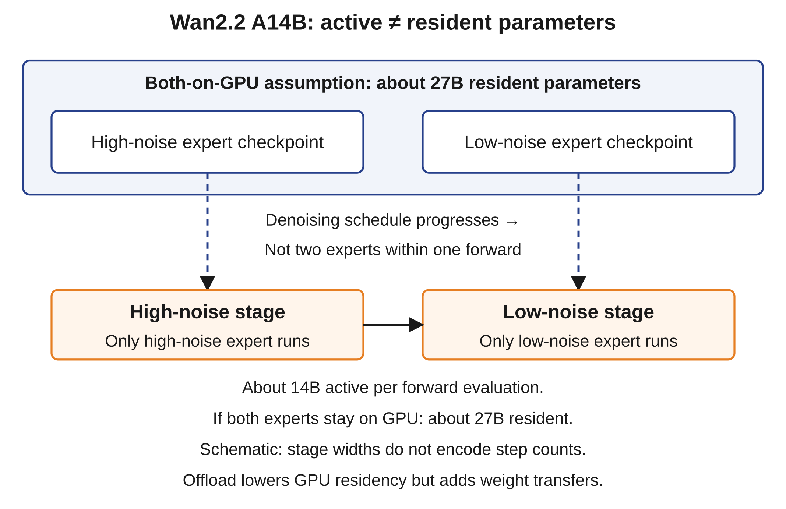
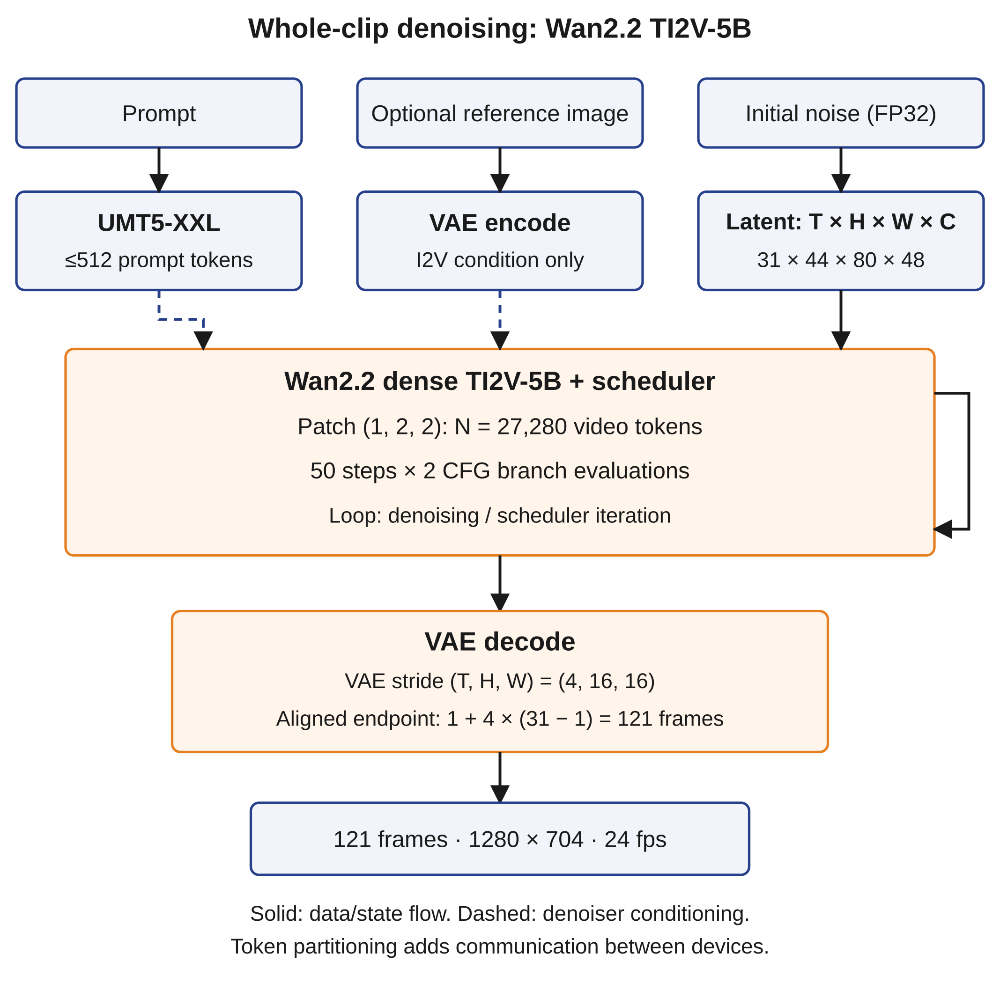

# Candidate insertions: video generation as a workload

Research snapshot: 2026-10-28 UTC. Book evidence cutoff: 2026-08-30. These passages are not applied to the manuscript. The canonical enterprise-Q&A example remains unchanged. Figure labels V1/V2 are proposal identifiers, not final book numbers. Facts about current engines and APIs belong to the explicitly later snapshot below, not silently inside the August edition.

All video additions below form a controlled update under that dated snapshot. Earlier release events do not prove that the current inspected main-branch code, licenses, and runtime support were identical before the cutoff. Strict August-only integration would require historical tags/commits to be rechecked; this package does not claim that historical audit.

## Editorial placement map

| Candidate anchor | Exact source placement | Purpose / non-duplication |
|---|---|---|
| `video-work-unit` | Ch2, §1 Concept, after the causal-chain paragraph currently at `chapter-02.md:54–58`, before §2 Mental Model | One scope bridge. Does not repeat the prefill/decode derivation. |
| `video-expert-residency` | Ch3, §6 Architecture Consequence, after `The 2026 baseline shift: same framework, new constants`, before §7 (`chapter-03.md:116–134`) | A short boundary case for total versus active parameters; not a new MoE tutorial. Figure V2. |
| `video-memory-boundary` | Ch7, end of §2 Mental Model, before §3 (`chapter-07.md:20–24`) | Scope the persistent-state formula; no change to the canonical KV table. |
| `video-resource-budget` | Ch8, end of §6 Architecture Consequence, before §7 (`chapter-08.md:167–179`) | The only numerical video worked example. Figure V1. |
| `video-serving-boundary` | Ch11, §6, after the mechanisms comparison and before §7 (`chapter-11.md:149–151`) | Map the existing four serving concerns onto whole-clip work; no product catalogue. |
| `video-benchmark-contract` | Ch14, end of §4 Measurement, before §5 (`chapter-14.md:53–62`) | A compact benchmark contract, not vendor speed rankings. |
| `video-fleet-unit` | Ch20, end of §6 Architecture Consequence, before §7 (`chapter-20.md:81–91`) | One economics and placement consequence; preserve existing fleet arithmetic. |
| `video-snapshot-20261028` | Separate dated technology note, linked from Ch11, not retroactively included in the August cutoff | Current model/runtime comparison, limitations, and licenses. |

Line anchors identify the inspected Markdown source, not a physical PDF page. No page-layout or publication-readiness claim follows from these placements. If an editor chooses one consolidated later note instead of dispersed insertions, the same passages can be grouped in causal order; they should not be printed twice.

## Candidate text — Ch2 scope bridge {#video-work-unit}

### The work unit changes with the generator

The prefill/decode split describes the autoregressive text path developed here. It does not describe every generative workload. In whole-clip latent video generation, a prompt conditions repeated updates to a space-time tensor. One denoising step can process the entire current clip representation. A later VAE decoder maps the final representation into frames. Its name, “decode,” does not make it the single-token decode loop in Fig 2.1. [1P][FACT][^WLOOP]

The causal method still holds. We first identify the generated object and its execution schedule. Those determine compute, live state, communication, and the useful completion event. For video, frame count, pixel dimensions, latent token count, and model evaluations replace “output text tokens” as separate quantities. None is a universal conversion factor for the others. Figure V1 in the compute chapter follows one such request. The canonical Q&A arithmetic remains the text case, not a template for replacing video frames with text tokens. [1P][DERIVED][^W5]

## Candidate text — Ch3 mechanism boundary {#video-expert-residency}

### An expert can be selected by noise stage

Wan2.2 A14B provides a useful counterexample to treating every mixture of experts as per-token top-k routing. Its high-noise and low-noise experts handle different parts of the denoising trajectory. The implementation selects the expert from the current timestep. The official description gives approximately 27B total parameters and approximately 14B active parameters. These are rounded published counts, not two exact 14B counts to be added. [1P][FACT][^W22]

Figure V2 separates selection from residency. If both expert checkpoints remain on GPU, both occupy weight memory even though only one expert runs in a branch evaluation. Explicit offload changes that placement. It introduces a weight-transfer operation and may lengthen the transition or interfere with other transfers. It does not change the model into a smaller checkpoint. The two noise stages also do not imply equal numbers of scheduler timesteps. [1P][FACT][^WSELECT]

Figure V2 — Wan2.2 A14B selects experts as the denoising schedule progresses. The stage-transition arrow spans timestep evaluations; it does not chain both experts inside one forward evaluation. Each expert is stored in its respective checkpoint. Both occupy GPU weight memory only if both remain on GPU; only the selected expert runs in a branch evaluation. Official rounded counts are about 27B total and about 14B active, not an inferred per-expert parameter split. Stage widths are schematic and do not encode step counts. Explicit offload changes residency and adds transfers. This is a different model from the dense 5B example. [1P][FACT][^W22][^WSELECT]

The reusable distinction is total weight storage versus active execution. The language-model cache conclusion remains scoped to the attention geometry and execution path that produced it. Noise-stage selection does not establish an autoregressive KV cache for a video denoiser.

## Candidate text — Ch7 memory scope {#video-memory-boundary}

### Persistent state is architecture-specific

The KV formula in this chapter describes keys and values retained across autoregressive steps. A whole-clip denoiser has a different lifetime model. Its latent video changes after each scheduler update. Video keys and values therefore cannot simply be retained as immutable prefix entries for every later step. The inspected Wan2.2 path recomputes attention from the current clip representation. Static prompt embeddings can remain reusable, but that is not the growing autoregressive cache. [1P][FACT][^WLOOP][^WATTN]

The corresponding fit test includes resident weights and encoders, latent and scheduler state, per-layer activations, attention workspace, temporary conversion buffers, and VAE reconstruction. The peak is the maximum of the live allocations at each stage, not the sum of all tensors ever created. Tiled or chunked reconstruction can reduce a decoder peak without reducing the denoiser's token count. CPU offload can reduce GPU residency while adding host-memory and transfer requirements. A model that loads successfully has not yet passed the largest-shape inference test. [1P][FACT] implementation mechanisms; [ILLUSTRATIVE][DERIVED] budget interpretation.[^W22][^H15]

## Candidate text — Ch8 worked example {#video-resource-budget}

### From video dimensions to repeated attention work

A worked example makes the new work unit concrete. We use Wan2.2 TI2V-5B in its text-to-video path, not the A14B expert model. Its configuration specifies a dense transformer with hidden width 3,072, 30 layers, and 24 attention heads. The VAE has 48 latent channels and temporal/spatial strides of 4, 16, and 16. The denoiser patches the latent video by `(1,2,2)`. The release's “720P” example is precisely 1,280 × 704 pixels, 121 frames, at 24 frames/s. The dimensions, rather than the marketing resolution label, determine the budget. [1P][FACT][^W5]

Figure V1 shows the data path. The prompt passes through UMT5-XXL. An optional image follows a separate reference-conditioning path. The T2V calculation below does not add that I2V branch to its state budget. Initial noise spans the entire latent video. Each scheduler step calls the denoiser on this representation; VAE decoding follows the final update. [1P][FACT][^WLOOP]

Figure V1 — Wan2.2 TI2V-5B whole-clip denoising. The T2V worked example starts from a 31×44×80×48 latent tensor and patchifies it into 27,280 video tokens. The fetched implementation uses T_l=(F−1)//4+1, H_l=H//16 and W_l=W//16. For aligned F=4k+1, F=1+4(T_l−1): 31 latent time positions correspond to 121 frames. The optional I2V branch is separate from the T2V budget. The feedback loop is denoising/scheduler iteration, not architectural recurrence. Fifty upstream timesteps use two CFG branch evaluations each. The VAE decode is not autoregressive text decode. [1P][FACT] geometry and loop; [1P][DERIVED] aligned inverse and token count. Schematic, not a latency or peak-memory measurement.[^W5][^WLOOP]

For this aligned shape, the temporal latent count includes the first-frame convention:

\[
T_l=\left\lfloor\frac{F-1}{4}\right\rfloor+1=31,
\qquad H_l=704/16=44,\qquad W_l=1280/16=80.
\]

There are 109,120 latent spatial-temporal cells, each with 48 channels. Patching reduces the number of transformer positions:

\[
N=T_l\frac{H_l}{2}\frac{W_l}{2}
 =31\times22\times40=27{,}280.
\]

Channels contribute features to each token; they do not multiply the token count. Sequence-parallel implementations may pad this length to a device-partition multiple. Conditioning tokens and condition tensors require separate accounting. [1P][DERIVED][^WLOOP]

For batch size one, full noncausal attention with hidden width \(d\) requires approximately

\[
C_{\mathrm{attention,layer}}=4N^2d
\]

FLOP for the two matrix products \(QK^T\) and \(AV\), counting a multiply-add as two FLOP. This excludes projections, MLPs, normalization, softmax, text cross-attention, and the decoder. Wan's inspected default sets `causal=False` and `window_size=(-1,-1)`. A triangular autoregressive reduction does not apply. [1P][FACT] attention mode; [1P][DERIVED] arithmetic.[^WATTN]

At this shape the attention core requires 9,144,709,939,200 FLOP per layer, or about 9.145 TFLOP. Across 30 layers it requires about 274.341 TFLOP per branch evaluation. The inspected upstream loop evaluates conditional and unconditional predictions separately at each of its 50 default scheduler timesteps. That is 100 single-sample branch evaluations, giving about 27.434 PFLOP of attention-core work over the trajectory. This is not the whole model's FLOP count and is not a GPU execution time. A runtime may batch the two branches into one forward call without removing their two-sample arithmetic. [1P][DERIVED][^W5][^WLOOP]

The memory calculation has an equally important boundary. One hypothetical BF16 hidden tensor contains \(N\times d\times2=167{,}608{,}320\) bytes. Materializing one BF16 score tensor for 24 heads would require \(24\times N^2\times2=35{,}721{,}523{,}200\) bytes, or about 33.268 GiB. This is a hypothetical implementation choice, not a claim that FlashAttention allocates such a tensor. Tiled exact attention avoids retaining the full score matrix while still performing the pairwise work. The upstream code creates initial latent noise in FP32, so assigning BF16 to every live tensor would also undercount state. [1P][DERIVED][^WATTN][^WLOOP]

The sensitivity explains the architectural consequence. Extending 121 to 241 frames changes the temporal latent count from 31 to 61. Token count rises by about 1.968×; the dense pairwise term rises by about 3.872×. Doubling both spatial dimensions gives four times the tokens and sixteen times the pairwise work. These are algebraic sensitivities, not claims that either larger workload meets the release's quality or memory envelope. A request limit expressed only in clip-seconds misses this distinction. [1P][DERIVED]

At 24 frames/s, 121 frames also exposes a measurement convention. The final frame's timestamp is 5 seconds after the first. A constant-frame-duration container spans \(121/24\), or about 5.0417 seconds. A service contract needs one convention. “Five-second clip,” “121 frames,” and “27,280 latent tokens” describe related but different quantities.

## Candidate text — Ch11 serving boundary {#video-serving-boundary}

### The serving concerns transfer; the text mechanisms do not transfer automatically

A video service still schedules requests, manages live state, reuses valid work, and chooses resource-specialized pools. The mechanisms implementing those concerns differ. The inspected full-clip Wan path does not emit a completed next frame at each denoising step. A step boundary can be a scheduling or cancellation point if the runtime exposes it, but it is not automatically a text continuous-batching boundary. Jobs with different shapes, samplers, guidance branches, and timestep schedules may be difficult or wasteful to batch together. [1P][FACT] model execution; [ILLUSTRATIVE][HYPOTHESIS] scheduling consequence.[^WLOOP]

A useful admission record therefore includes the checkpoint revision, task type, exact height and width, frame count, audio/reference inputs, schedule, guidance method, precision, and parallel layout. Shape-aware buckets limit padding and kernel recompilation. A deadline-aware dispatcher can separate interactive previews from full-quality completion. It must include queue age and avoid starving long jobs. A low-step preview is a separate quality contract unless the implementation proves that its state can continue into the final recipe. A preview image, first decoded frame, and finalized downloadable clip are three different completion events.

Per-request memory limits follow measured peaks for each admitted configuration. The largest VAE reconstruction, full-clip attention workspace, compiler workspace, and overlapping transfers can bind even when the weight set fits. Offload and quantization change those peaks only where the actual kernels support the chosen representation. A quantized checkpoint file alone does not establish faster execution, adequate reconstruction quality, or a supported attention backend. [1P][FACT] documented offload paths; [ILLUSTRATIVE][HYPOTHESIS] deployment consequences.[^W22][^H15]

Parallelism also changes the cost of a step. Sequence or context parallelism partitions video positions and exchanges attention data. Tensor parallelism partitions model operations and introduces its own collectives. Weight sharding is a residency technique, not a synonym for either. Wan2.2's official multi-GPU path combines FSDP and Ulysses; its attention-head divisibility constraint is part of the deployable configuration. More aggregate GPU memory does not establish that an arbitrary partition or mixed-speed GPU group is valid or fast. Repeated synchronization can make the slowest device or weakest link determine the step time. [1P][FACT] supported path; [ILLUSTRATIVE][HYPOTHESIS] performance boundary.[^W22]

The end-to-end clock starts at request acceptance and ends only after the promised media artifact is available. Model denoising, VAE decode, frame transfer, video encoding, audio muxing, safety checks, storage upload, and delivery can all extend that clock. Encoder-heavy postprocessing may merit a separate CPU or GPU pool, but the transfer and queue cost must be measured. A text prefill/decode split does not prove that the same split is useful here.

## Candidate text — Ch14 measurement contract {#video-benchmark-contract}

### A video benchmark is a workload tuple

A reproducible video result identifies the exact model and revision; task and conditioning; hardware model, count, and topology; precision and quantization; pixel dimensions; frames and frames/s; scheduler and timestep sequence; guidance; branch evaluations; engine commit and attention backend; cache and offload settings; and output-quality criteria. It also identifies the timing boundary. Seconds per denoising step, seconds for all sampling steps, and seconds to a finalized clip are not interchangeable. [ILLUSTRATIVE][DERIVED] benchmark-contract extension.

A primary report can still leave that tuple incomplete. HunyuanVideo-1.5 reports 5.5070 versus 2.9475 seconds per diffusion step for dense versus sparse attention at 720 × 1,280 pixels and 241 frames. Those measurements use eight H800 GPUs with context parallelism and a CFG-distilled model. Its separate 50-step table adds SageAttention, compilation, and feature caching, and reports 96.78 versus 58.39 seconds for the same shape. Neither table establishes a single-GPU service rate or a complete request-to-media latency. [1P][FACT][^H15]

LTX-2's report compares 22.30 seconds/step for Wan2.2-14B with 1.22 seconds/step for LTX-2. The stated context is an H100 GPU, 121 frames, a 720p label, single-step Euler, and CFG=1. It is not a matched-quality completed-clip comparison. Missing precision, exact pixel shape, engine revision, and per-run quality prevent a price-per-usable-clip conclusion. The appropriate response to incomplete evidence is a bounded deployment experiment, not a TFLOP-to-price conversion. [1P][FACT][^LTX]

The deployment experiment pairs fixed prompts and reference assets across explicitly declared recipes. Warm and cold runs remain separate. Quality evaluation includes prompt adherence, identity and object persistence, motion continuity, flicker, geometry and physical plausibility, text rendering, and, where applicable, lip synchronization and speaker assignment. Quality gates and failure categories are fixed before throughput is compared. Reduced steps, approximate caches, sparse attention, and quantization are tested as separate quality-performance points, not treated as identical work.

## Candidate text — Ch20 fleet unit {#video-fleet-unit}

### The useful completion is an accepted clip

For a fixed output contract, a video fleet can report completed clips/s and generated frames/s together. Frames/s alone is ambiguous: larger frame counts can increase reported output work while reducing completed jobs. Across changing durations and frame rates, generated clip-seconds/s also needs a stated denominator and does not normalize the nonlinear attention cost.

A useful goodput definition counts clips that satisfy the completion deadline, output-integrity checks, quality gate, and safety requirements in the same observation window. Rejections, OOMs, cancellations, retries, and unusable outputs remain visible as separate counters. The cost per accepted clip divides the total allocated cost of that window—including idle capacity and failed attempts—by the accepted-clip count. Storage, delivery, encoding, and license costs enter explicitly rather than disappearing into a GPU-seconds estimate. [ILLUSTRATIVE][DERIVED] proposed service accounting.

Shape-specific measured service time and peak memory determine placement. Warm replicas trade idle cost for avoiding checkpoint downloads, initialization, compilation, and encoder loading on the request path. Heterogeneous pools can separate preview, denoising, and reconstruction contracts where measurement justifies the transfer. Replicas add independent job capacity; sequence-parallel groups can make a larger job feasible or reduce its service time at a communication cost. These are different scaling actions. The existing distinction between analytical capacity bounds and measured SLO-goodput remains unchanged.

## Candidate dated technology note {#video-snapshot-20261028}

### Video systems snapshot — 28 October 2026

This note extends the book's 30 August 2026 evidence cutoff explicitly. It records inspected public sources, not an exhaustive claim about private, gated, regional, or unretrieved releases. Model release dates and engine support dates remain separate.

The most useful comparison is not a ranking. It is which mechanism changes the resource model:

| Inspected model / path | Mechanism with evidence | Architectural consequence / boundary |
|---|---|---|
| Wan2.2 TI2V-5B | Dense whole-clip DiT; VAE stride (4,16,16); patch (1,2,2) | Compact video token grid. Peak workspace and repeated whole-clip work still matter. The worked example uses this model only. |
| Wan2.2 T2V/I2V-A14B | Noise-stage experts; about 27B total / 14B active; VAE stride (4,8,8) | Active compute and resident weights differ. Its token geometry is not the 5B geometry. |
| HunyuanVideo-1.5 | 8.3B; high-compression VAE; selective/sliding tile attention; distilled variants | Sparse attention and fewer evaluations are distinct optimization axes. A report's sparse checkpoint does not prove availability of every task variant. |
| LTX-2 / LTX-2.5 | LTX-2 report describes coupled video/audio streams and multistage inference; 2.5 is a separately documented release | Audio tokens, cross-modal work, upsampling, and multiple passes require their own budget. LTX-2 constants are not automatically LTX-2.5 constants. |
| `wan3.0-video` / `wan3.0-video-prime` | Current official asynchronous hosted API, labeled preview | Service contract is visible; public weights, parameter count, VAE geometry, and self-hosted runtime are not established by that API. |

[1P][FACT] mechanisms and product labels; resource consequences are scoped deductions.[^W22][^W5][^H15][^LTX][^LTX25][^WANAPI]

Wan's specialized paths further separate the task from the family name. Wan2.1 VACE supports video creation and editing through explicit condition representations. Wan2.2-S2V-14B conditions video on supplied audio, with reference-image and optional pose inputs; this is not evidence that the base model synthesizes native audio from text. Wan-Dancer and Wan-Animate-2 expose additional motion and animation research paths. Their recipes, auxiliary encoders, and quality criteria remain distinct from T2V. [1P][FACT][^VACE][^S2V][^DANCER][^ANIMATE]

Wan-Animate-2 also demonstrates why the attention boundary must follow the exact variant. Its Base path separates reference and denoising branches and uses sparse reference attention. Its Lite path instead applies causal chunk dependencies; the report illustrates eight-frame segments of the driving stream. Tokens in a current noisy chunk attend to preceding clean context and to one another. This is chunk-wise autoregression around iterative generation, not a single-token text decode loop. Earlier chunk delivery can change the latency contract, but accumulated errors and retained history still require a budget. The report does not establish a particular KV-cache layout or an unlimited constant-memory stream. [1P][FACT] architecture; [ILLUSTRATIVE][DERIVED] serving boundaries.[^ANIMATE]

Versioned implementation evidence is also narrower than production validation. Diffusers v0.35.0 documents Wan2.2; v0.37.0 introduces LTX-2; v0.40.0 documents Wan-Animate-2; v0.42.0 contains LTX-2.5 and HunyuanVideo-1.5 pipeline documentation. Their published release dates are 19 August 2025, 5 March 2026, 20 August 2026, and 23 October 2026 respectively. The last is outside the book cutoff. The existence of a pipeline does not establish a validated queueing service, multi-tenant isolation, every kernel backend, or a latency SLA. [1P][FACT][^ENGINES]

Two evidence limits remain material. LTX-2's report uses 14B+5B in its abstract and 13B+3B in its conclusion; this note does not choose an exact total from that conflict. LTX-2.5's official release notes date it to 11 August 2026, but raw gated configuration requests were not accessible in this investigation. Its official 22B label is not a tensor-count audit. The license text is accessible and must be considered separately. [1P][FACT][^LTX][^LTX25]

Public weights do not remove rights or safety obligations. Wan's inspected releases identify Apache-2.0, while LTX-2.5 and HunyuanVideo-1.5 use community licenses with commercial or territorial conditions. Input-image, audio, likeness, music, and output-use permissions are separate questions. Provenance records can retain checkpoint revision, recipe, seed, source-asset rights, moderation decisions, and output hashes. Such records support investigation; they do not establish that an output is legally cleared or factually authentic. No legal conclusion is implied. [1P][FACT] license observations; [ILLUSTRATIVE][DERIVED] provenance design.[^LICENSES]

## Citation definitions and evidence mapping

These are retrieved primary sources. Exact archive hashes, retrieval timestamps, section locators, and support boundaries are in `claims.json` and `source-catalogue.md`. The two figures' full captions, alt text, editable sources and reproduction commands are in `figures/manifest.json`.

[^W22]: Wan official README, release history, architecture, inference, licenses. https://github.com/Wan-Video/Wan2.2/tree/1ea34ff48f87168174e12956e200b1d908b1c5ff . Claims VG002–VG004, VG030–VG031, VG035. Wan2.2's report link resolves to the older Wan report; it is not treated as a Wan2.2-specific paper.
[^W5]: Wan2.2 official TI2V-5B configuration. https://github.com/Wan-Video/Wan2.2/blob/1ea34ff48f87168174e12956e200b1d908b1c5ff/wan/configs/wan_ti2v_5B.py . Cross-check: https://huggingface.co/Wan-AI/Wan2.2-TI2V-5B-Diffusers/blob/main/transformer/config.json and https://huggingface.co/Wan-AI/Wan2.2-TI2V-5B-Diffusers/blob/main/vae/config.json . Claims VG005–VG006, VG024–VG028. Arithmetic: `verify_sources_and_math.py`, `calculations.json`.
[^WLOOP]: Wan TI2V implementation, shape construction and sampling loop. https://github.com/Wan-Video/Wan2.2/blob/1ea34ff48f87168174e12956e200b1d908b1c5ff/wan/textimage2video.py . Claims VG007–VG010, VG024–VG029.
[^WSELECT]: Wan text-to-video expert selection. https://github.com/Wan-Video/Wan2.2/blob/1ea34ff48f87168174e12956e200b1d908b1c5ff/wan/text2video.py . Claims VG003–VG004.
[^WATTN]: Wan attention implementation and default model geometry. https://github.com/Wan-Video/Wan2.2/blob/1ea34ff48f87168174e12956e200b1d908b1c5ff/wan/modules/attention.py and https://github.com/Wan-Video/Wan2.2/blob/1ea34ff48f87168174e12956e200b1d908b1c5ff/wan/modules/model.py . Claims VG008, VG026–VG029.
[^H15]: HunyuanVideo-1.5 Technical Report, arXiv:2511.18870, especially model architecture and §6 Tables 7–8. https://arxiv.org/html/2511.18870 . Official repository: https://github.com/Tencent-Hunyuan/HunyuanVideo-1.5 . Claims VG022–VG023, VG033. Timing results are vendor-reported, not measurements from this research.
[^LTX]: LTX-2: Efficient Joint Audio-Visual Foundation Model, arXiv:2601.03233, architecture, §6.3/Table 1, limitations and conclusion. https://arxiv.org/html/2601.03233 . Claims VG019, VG021, VG034.
[^LTX25]: Official release notes: https://ltx.io/release-notes ; official model page: https://ltx.io/model/ltx-2-5 ; versioned Diffusers documentation: https://github.com/huggingface/diffusers/blob/v0.42.0/docs/source/en/api/pipelines/ltx2.md . Claim VG020. Gated raw configurations remain unverified.
[^WANAPI]: Alibaba Cloud Model Studio, current video overview and Wan3 API reference. https://www.alibabacloud.com/help/en/model-studio/video-editing-and-generation and https://www.alibabacloud.com/help/en/model-studio/wan3-video-generation-api-reference . Claims VG017–VG018, VG038, VG042. Retrieved 2026-10-28; preview status is material.
[^VACE]: VACE: All-in-One Video Creation and Editing, arXiv:2503.07598, §3.3; official code https://github.com/ali-vilab/VACE . https://arxiv.org/html/2503.07598 . Claims VG001, VG014.
[^S2V]: Official Wan-S2V technical report, §3–4. https://humanaigc.github.io/wan-s2v-webpage/content/wan-s2v.pdf ; official card https://huggingface.co/Wan-AI/Wan2.2-S2V-14B . Claims VG012–VG013.
[^DANCER]: Wan-Dancer official code https://github.com/Wan-Video/Wan-Dancer ; report https://arxiv.org/html/2607.09581 . Claim VG015.
[^ANIMATE]: Wan-Animate-2 report https://arxiv.org/html/2608.06009 and official repository https://github.com/Wan-Video/Wan-Animate-2 . Claims VG016, VG043. The report was first submitted on 6 August 2026 and revised on 8 August 2026. Its Lite three-step distillation and the README's ten-step example are different recipes.
[^ENGINES]: Official release metadata: https://api.github.com/repos/huggingface/diffusers/releases/tags/v0.35.0 ; https://api.github.com/repos/huggingface/diffusers/releases/tags/v0.37.0 ; https://api.github.com/repos/huggingface/diffusers/releases/tags/v0.40.0 ; https://api.github.com/repos/huggingface/diffusers/releases/tags/v0.42.0 . Corresponding versioned pipeline sources archived locally. Claim VG032.
[^LICENSES]: Wan license https://github.com/Wan-Video/Wan2.2/blob/1ea34ff48f87168174e12956e200b1d908b1c5ff/LICENSE.txt ; LTX-2.x license https://github.com/Lightricks/LTX-2/blob/e98f6d927d83c92ef2be6aec76c8440b19306e39/LICENSE-2_x ; Hunyuan license https://github.com/Tencent-Hunyuan/HunyuanVideo-1.5/blob/main/LICENSE . Exact retrieved license URLs are additionally preserved in `source-catalogue.md`; claims VG035–VG037. License observations are not legal advice.
